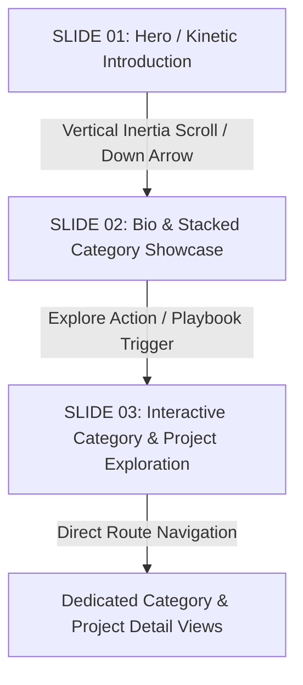

# Reference Video Analysis & Three-Slide Experience Specification
**Reference Source**: Purrweb "Landing | Designer portfolio" (Dribbble Shot `19871911-Landing-Designer-portfolio`)  
**Authentic Stream**: `https://cdn.dribbble.com/userupload/3989861/file/original-1f1610f0a43c0aed537ab125d7ef8e45.mp4`  
**Brand & Persona**: Indra Wijaya — Creative Developer & Motion Designer  
**Target Disciplines**: Motion Graphics, Video Editing, Visual Design, Web Development  

---

## 1. Frame-by-Frame Structure & Slide Anatomy

The reference video presents a continuous, cinematic 3-slide visual narrative connected by smooth scroll and depth transitions:

---

## 2. Deep Dive: Three-Slide Specifications

### SLIDE 01 — Hero / Kinetic Introduction
* **Background & Lighting**:
  - Base tone: Deep black-navy (`#050608`).
  - Lighting: Soft diagonal spotlight ellipse (`rotate(-28deg)`) from top-right to center with deep blue/navy gradations (`#24527A` 65% opacity $\rightarrow$ `#112A45` 45% opacity $\rightarrow$ transparent, blurred with 110px Gaussian filter).
  - Fine SVG film grain overlay (`mix-blend-overlay`, 0.045 opacity).
* **Top Navigation Bar (4-Column Layout + Language Toggle)**:
  - Column 1 (Left): `INDRA WIJAYA` (Bold uppercase, tracking +0.04em).
  - Column 2: `PLAYBOOK` (Interactive trigger to open Project Explorer / Category routes).
  - Column 3: `SOCIALS` (Dropdown with Behance, Vimeo, LinkedIn, YouTube, Instagram).
  - Column 4 (Right): `CONTACTS` + Language Switcher `[ ID | EN ]`.
* **Central Kinetic Headline**:
  - Line 1: `"Creative "` (Crisp modern sans-serif, white `#F3F4F6`, clamp 4.2rem to 9.5rem) paired with dynamic rotating word:
    - `"developer"` $\rightarrow$ `"motion"` $\rightarrow$ `"visual"` $\rightarrow$ `"creative"`
    - Styled in **Italic Serif** (*Playfair Display* / serif), warm golden amber (`#E68A1E`).
  - Line 2: `"designer"` (Menjorok ke kanan 18vw tepat di bawah `"Creative"`).
* **Interactive Optical Magnifying Glass Lens**:
  - 240px circular aperture following cursor with 60fps hardware-accelerated translation.
  - Optical glass ring (`border: 1px solid rgba(255,255,255,0.35)`, `box-shadow: inset 0 0 20px rgba(255,255,255,0.08)`, subtle backdrop-blur).
  - Magnified duplicate text layer scaled to `1.22x` radiating directly from the cursor center (`transformOrigin: "${relX}px ${relY}px"`).
  - Soft chromatic dispersion text shadow (red-orange & cyan-blue spectral refraction):
    `-7px -3px 12px rgba(255, 95, 20, 0.9), 7px 3px 12px rgba(30, 165, 255, 0.9), -3px 2px 6px rgba(255, 140, 50, 0.65), 3px -2px 6px rgba(60, 200, 255, 0.65), 0px 0px 20px rgba(255, 255, 255, 0.35)` with `filter: blur(2.8px) contrast(1.08)`.
* **Bottom Metadata**:
  - Left: 2-column monospace summary (Specializations, Worldwide Availability, Location: Indonesia).
  - Right: Minimalist vertical 56px scroll line with animated pulse and down arrow.

---

### SLIDE 02 — Main Portfolio Showcase & 3-Card Category Deck
* **Layout**: Asymmetric 12-column grid.
* **Left Column (7 cols)**:
  - Eyebrow badge: `ABOUT & CREATIVE PHILOSOPHY`.
  - Signature intro statement in both languages:
    - EN: *"I am Indra Wijaya, I create unconventional yet functional & visually pleasing motion, video, and web experiences."*
    - ID: *"Saya Indra Wijaya, saya menciptakan pengalaman motion, video, dan web yang tak konvensional namun fungsional & estetis."*
  - Supporting bio explaining commercial motion, video editing, and modern web engineering.
  - Action buttons: `OPEN PLAYBOOK` (Solid white button) and `DISCUSS COLLABORATION` (Dark outline button).
* **Right Column (5 cols) — 3-Card Category Stack Deck**:
  - **Card 1 (Front, Focus)**: *MOTION GRAPHICS* (sharp `blur(0px)`, scale 1.0, active looping video preview).
  - **Card 2 (Middle)**: *VIDEO EDITING* or *VISUAL DESIGN* (offset scale 0.94, `blur(6px)`, translateY -20px).
  - **Card 3 (Back)**: *WEB DEVELOPMENT* (offset scale 0.88, `blur(12px)`, translateY -40px).
  - **Interactions**:
    - Hovering or clicking a back card shuffles the deck and brings that category to the front.
    - Clicking the active front card or arrow opens the dedicated category route.

---

### SLIDE 03 — Interactive Project Exploration (The Playbook)
* **Visual Presentation**:
  - Full project gallery and filterable matrix.
  - Four dedicated category tabs:
    1. `MOTION GRAPHICS` (`/work/motion-graphics`)
    2. `VIDEO EDITING` (`/work/video-editing`)
    3. `VISUAL DESIGN` (`/work/visual-design`)
    4. `WEB` (`/work/web`)
  - Multi-ratio project items (`16:9`, `9:16`, `1:1`) with real video preview loops on hover.
  - Badge stack showing software and technologies: `After Effects`, `Premiere Pro`, `Photoshop`, `Illustrator`, `Next.js`, `React`, `GSAP`, `Tailwind CSS`.
  - Every project links to its dedicated detail route `/work/[category]/[slug]`.

---

## 3. Slide Transitions & Interaction Model
1. **Vertical Transition (Slide 1 $\rightarrow$ Slide 2)**:
   - Driven by Lenis smooth-scrolling with spring physics easing.
   - Pinned background spotlight remains steady while content moves with subtle parallax.
2. **Category Transition (Slide 2 $\rightarrow$ Slide 3 / Dedicated Routes)**:
   - Direct navigation to clean URLs (`/work/[category]`).
   - Browser back and forward history fully functional.
3. **Project Detail Transition**:
   - Seamless navigation to `/work/[category]/[slug]` with full media player, client context, and previous/next navigation.
