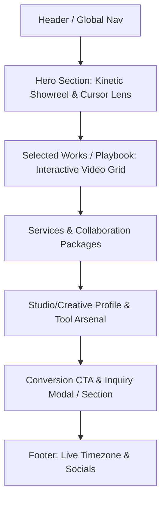

# SPEC-01: DATA ARCHITECTURE & CONTENT SCHEMA
**Phase**: 01 — Data Model & Information Architecture  
**Status**: DRAFT (Review Pending)  
**Scope**: Definisi skema konten & relasi data untuk Portofolio Motion Designer / Creative Studio (Dark Minimalist & Interactive Showreel).  
**Constraint**: Tidak ada kode aplikasi/implementasi framework. Format TypeScript Interface & JSON Schema digunakan murni sebagai kontrak data struktural.

---

## 1. Arsitektur Informasi & Navigation Sitemap

Website dirancang dengan struktur *high-impact single-page showcase* dengan kapabilitas *deep-linking* atau modal detail proyek tanpa merusak alur scroll.



### Rincian Bagian (Sitemap Component Tree)
1. **Header (Global Sticky/Floating Bar)**:
   - Wordmark / Studio Monogram
   - Real-time Availability Pill (`● Available for Projects` / `○ Fully Booked`)
   - Anchor Nav (`Selected Works`, `Services`, `Profile`, `Contact`)
   - Quick Action: `Start a Project`
2. **Hero (Showreel & Dynamic Canvas)**:
   - Kinetic Typography Loop (headline yang bertransformasi)
   - Dual-layer Video Engine: Ambient Background Blur Loop + Sharp Refraction Reveal (untuk interaksi kursor)
   - Audio Toggle (Mute/Unmute untuk immersive preview)
3. **Selected Works (The Playbook)**:
   - Filter Kategori: `All`, `Motion Graphics`, `Commercial / Ads`, `3D & Visuals`, `Brand Identity`
   - Feed Proyek dengan rasio dinamis (16:9 cinematic, 9:16 vertical reels)
   - Hover-to-preview video stream ringan
4. **Services & Capabilities (Creative Packs)**:
   - Daftar paket layanan kreatif (Motion Design for Product, Campaign Commercials, Kinetic Typography & Branding)
   - Rincian deliverable & alur kerja (*Brief → Styleframe → Animatic → Render*)
5. **Creative Profile & Hardware/Software Arsenal**:
   - Filosofi desain & bio ringkas
   - Daftar software / workflow tools (Premiere Pro, DaVinci Resolve, After Effects, Cinema 4D/Blender, Plugins)
6. **Contact & Project Inquiry**:
   - Direct Contact (Email, WhatsApp, Discord/Telegram)
   - Filter perkiraan budget & timeline
7. **Footer**:
   - Dynamic Local Time (WIB / GMT+7)
   - Copyright & Social Networks (Behance, Vimeo, YouTube, Instagram, LinkedIn)

---

## 2. Definisi Skema Data (TypeScript Type Contracts)

### A. Site Identity Schema (`SiteIdentitySchema`)
Mendefinisikan identitas pemilik portofolio, mode operasional (apakah personal moniker atau creative studio), status ketersediaan, serta spesialisasi software/tools.

```typescript
export type OperationalMode = 'STUDIO_CREATIVE' | 'PERSONAL_FREELANCER';

export type AvailabilityStatus = 
  | 'AVAILABLE_IMMEDIATE'   // Siap terima proyek baru
  | 'SELECTIVE_PROJECTS'    // Hanya menerima proyek skala tertentu
  | 'BOOKED_OUT';           // Sedang penuh hingga periode tertentu

export interface ToolItem {
  id: string;
  name: string;             // Contoh: "DaVinci Resolve Studio", "Adobe After Effects"
  category: 'COMPOSITING_MOTION' | 'COLOR_EDITING' | '3D_CGI' | 'AUDIO_DESIGN' | 'PLUGINS_SCRIPTS';
  iconIdentifier: string;   // Identifier ikon SVG
  proficiencyLevel?: 'MASTER' | 'ADVANCED' | 'CORE_STACK';
}

export interface SocialLink {
  platform: 'BEHANCE' | 'VIMEO' | 'INSTAGRAM' | 'YOUTUBE' | 'LINKEDIN' | 'WHATSAPP' | 'EMAIL';
  label: string;
  url: string;
  isPrimaryContact: boolean;
}

export interface SiteIdentitySchema {
  mode: OperationalMode;
  brandName: string;          // Contoh: "Indra Studio" atau "Indra Wijaya"
  legalName?: string;
  tagline: string;            // Contoh: "Sculpting Rhythm & Kinetic Motion for Bold Brands"
  shortBio: string;           // 1-2 kalimat positioning statement
  location: {
    city: string;
    country: string;
    timezone: string;         // Contoh: "Asia/Jakarta" (GMT+7)
  };
  availability: {
    status: AvailabilityStatus;
    badgeText: string;        // Contoh: "Available for Q4/2026 Projects"
    bookingSlotsOpenFrom?: string; // ISO date / bulan jika booked out
  };
  specializations: string[];  // Contoh: ["Kinetic Typography", "Commercial Editing", "CGI Motion", "Color Grading"]
  toolsArsenal: ToolItem[];
  socialLinks: SocialLink[];
}
```

---

### B. Showreel Hero Schema (`ShowreelHeroSchema`)
Mendefinisikan data untuk area paling atas layar, termasuk teks kinetik yang berganti dinamis dan sumber media ganda untuk efek lensa kursor.

```typescript
export interface KineticKeyword {
  id: string;
  text: string;               // Contoh: "KINETIC RHYTHM", "BOLD COMMERCIALS", "3D DYNAMICS"
  accentColor?: string;       // Hex / HSL aksen opsional saat kata kunci ini aktif
}

export interface ShowreelHeroSchema {
  headlinePrefix: string;     // Contoh: "Crafting High-Voltage"
  kineticKeywords: KineticKeyword[];
  headlineSuffix: string;     // Contoh: "for Next-Gen Brands & Creators."
  subText: string;            // Keterangan pendukung di bawah headline
  
  // Dual-Layer Video Assets untuk Refraction / Cursor Lens
  mediaSources: {
    // Layer 1: Ambient background (terdistorsi, redup, atau diburamkan secara artistik)
    ambientBlurVideoUrl: string;       // Optimized low-bitrate MP4/WebM (Muted, Loop)
    // Layer 2: Video tajam resolusi tinggi yang terkuak tepat di dalam radius kursor lensa
    sharpRevealVideoUrl: string;       // Ultra-sharp MP4/WebM sync loop
    // Fallback bila browser pengguna low-power mode atau menonaktifkan video
    fallbackPosterUrl: string;
    durationSeconds: number;
  };

  callToActions: {
    primary: {
      label: string;          // Contoh: "Watch Full Reel"
      actionType: 'OPEN_SHOWREEL_MODAL' | 'SCROLL_TO_PROJECTS';
      targetVideoUrl?: string;// URL video resolusi tinggi (YouTube/Vimeo embed atau direct CDN)
    };
    secondary: {
      label: string;          // Contoh: "Book a Project"
      targetSectionId: string;// e.g., "#contact"
    };
  };
}
```

---

### C. Project Item Schema (`ProjectItemSchema`)
Mendefinisikan spesifikasi setiap karya di galeri portofolio, mendukung video loop instan, berbagai rasio aspek (cinematic vs social vertical), breakdown peran teknis, serta tautan video penuh.

```typescript
export type ProjectCategory = 
  | 'MOTION_GRAPHICS'
  | 'COMMERCIAL_ADS'
  | '3D_VISUALS'
  | 'BRANDING_KINETIC'
  | 'EXPLAINER_PRODUCT';

export type AspectRatioType = 
  | '16:9'    // Landscape Cinematic / YouTube
  | '9:16'    // Vertical Social / Reels / TikTok Ads
  | '4:5'     // Portrait Feed
  | '1:1'     // Square Showcase
  | '21:9';   // Ultra-widescreen banner

export interface RoleContribution {
  roleName: string;          // Contoh: "Motion Director", "Color Grading", "Sound FX Sync"
  percentageOrScope?: string;// Contoh: "Lead 100%" atau "Compositing & Animation"
}

export interface ProjectItemSchema {
  id: string;
  slug: string;              // URL-friendly identifier unik (e.g. "tokopedia-hyperdrive-campaign")
  title: string;             // Judul Proyek
  client: {
    name: string;            // Nama Klien / Brand / Kreator
    industry?: string;       // Contoh: "Fintech", "Apparel", "SaaS", "Entertainment"
    logoUrl?: string;
  };
  category: ProjectCategory;
  year: number;              // Tahun produksi (misal: 2026)
  aspectRatio: AspectRatioType;
  
  // Media Assets
  media: {
    previewLoopUrl: string;  // Short silent video loop (3-7 detik, WebM/MP4, kompresi tinggi untuk fast load)
    posterThumbnailUrl: string; // Static fallback image / WebP
    fullVideoUrl: string;    // Full showcase video (YouTube, Vimeo unlisted, or Cloudflare Stream)
    videoDurationSeconds: number;
    hasAudio: boolean;       // Menandai apakah proyek memiliki audio asli saat dibuka
  };
  
  // Breakdown & Keterangan Proyek
  description: {
    challengeSnippet: string;// 1-2 kalimat ringkasan tantangan kreatif
    solutionSnippet: string; // 1-2 kalimat solusi motion & visual yang diterapkan
  };
  roles: RoleContribution[];
  toolsUsed: string[];       // Daftar tools yang dipakai di proyek ini: ["After Effects", "DaVinci Resolve"]
  
  // Highlight / Performance Metrics (Opsional)
  metrics?: {
    viewsOrReach?: string;   // Contoh: "1.4M+ Impressions"
    keyResult?: string;      // Contoh: "Winner - Best Visual 2025"
  };

  // Status Tampilan
  featured: boolean;         // Tampil di Hero / Top Spotlight
  sortOrder: number;         // Prioritas urutan tampil
}
```

---

### D. Service & Capability Schema (`ServicePackageSchema`)
Mendefinisikan penawaran paket pengerjaan untuk calon klien/brand/UMKM agar alur konversi jelas.

```typescript
export interface DeliverableItem {
  name: string;              // Contoh: "Storyboarding & Styleframes", "Render 4K 60FPS"
  description?: string;
}

export interface ServicePackageSchema {
  id: string;
  title: string;             // Contoh: "Commercial Motion & Ads"
  shortDescription: string;  // Penjelasan tujuan layanan
  deliverables: DeliverableItem[];
  turnaroundTime: string;    // Contoh: "5-10 Hari Kerja"
  idealFor: string;          // Contoh: "Brand & Agensi yang butuh video promosi campaign berdampak tinggi"
  startingFromPrice?: string;// Opsional (e.g. "Custom Quote" atau nominal)
}
```

---

## 3. Pertanyaan Klarifikasi untuk Mengunci Fase 1

Sebelum skema data ini dikunci dan kita beralih ke **Fase 2 (UI/UX Architecture & Interaction Specs)**, mohon konfirmasi untuk 4 hal berikut:

1. **Mode Identitas Portofolio**: Apakah nama brand yang akan ditampilkan adalah **Personal Brand** (misal: *Indra Wijaya — Motion Designer*) atau **Creative Studio / Collective Entity** (misal: *Indra Studio / Motion Lab*)?
2. **Koleksi Format Video Utama**: Apakah karya-karya yang akan dipamerkan mayoritas berformat **Landscape Cinematic (16:9)**, **Vertical Mobile / Reels (9:16)**, atau **Kombinasi Keduanya (Mixed Grid)**?
3. **Penyimpanan Video Preview**: Untuk video pendek *preview loop* (3-5 detik) dan *showreel hero*, apakah nantinya akan di-host secara **lokal/self-hosted (folder publik/assets MP4/WebM)**, atau diarahkan ke **layanan pihak ketiga (Vimeo / Cloudflare Stream / YouTube)**?
4. **Struktur Paket Layanan (Services)**: Apakah Anda ingin mencantumkan **kisaran harga estimasi (starting price)** secara terbuka, atau murni menggunakan model **Custom Quote / Inquiry Form**?
