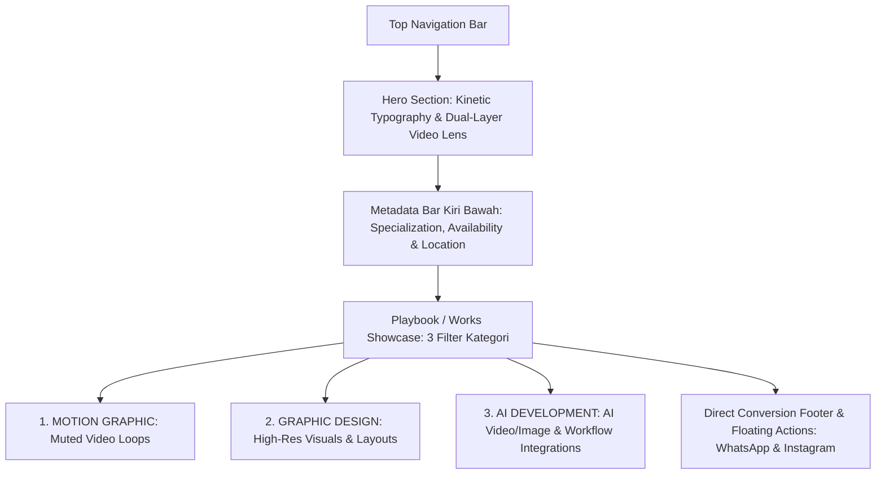
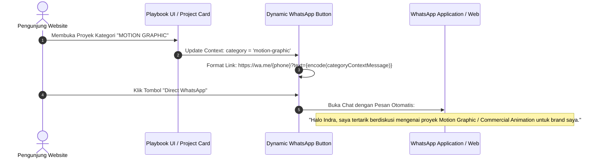

# SPEC-01: DATA MODEL & CONTENT ARCHITECTURE
**Project**: Portfolio Website Indra Wijaya — Creative Motion Designer & AI Development  
**Concept**: Interactive Dark Minimalist with Cursor Lens / Refraction & Dynamic Showreel (Inspired by Purrweb Designer Portfolio)  
**Phase**: 01 — Data Model & Information Architecture  
**Status**: DRAFT (Review Pending)  
**Constraint**: Murni spesifikasi skema data & arsitektur konten. DILARANG menulis kode aplikasi atau framework di luar direktori `/specs/`.

---

## 1. Arsitektur Informasi & Pemetaan Bagian Halaman

Website dirancang sebagai *high-impact single-page portfolio* dengan sistem filtrasi karya yang instan, interaksi kursor lensa pada Hero Showreel, dan konversi cepat tanpa friksi formulir email yang rumit.



### Pemetaan Relasi Data ke Setiap Bagian Halaman

1. **Header (Top Navigation Bar)**:
   - Wordmark Kiri Atas: `INDRA WIJAYA`
   - Menu Navigasi: `PLAYBOOK (WORKS)` | `SOCIALS` | `CONTACTS`
   - Live Availability Pill (Ketersediaan proyek)
2. **Hero Section (Interactive Dual-Layer Showreel)**:
   - Kinetic Headline: `"Creative "` + `[dynamic_word]` (font serif/italic dinamis: *"motion"*, *"visual"*, *"AI-driven"*) + `" designer"`
   - Dual-Layer Video Canvas: Ambient Blur Background + Sharp Reveal Lens (mengikuti kursor mouse)
   - Quick CTA: Scroll to Works / Direct WhatsApp
   - **Kiri Bawah (Metadata Bar)**:
     - Spesialisasi: `MOTION GRAPHIC / GRAPHIC DESIGN / AI DEVELOPMENT`
     - Status: `CURRENTLY AVAILABLE FOR FREELANCE & COLLABORATION`
     - Lokasi: `INDONESIA (WORLDWIDE REMOTE)`
   - **Kanan Bawah (Interactive 3 Stacked Cards Deck)**:
     - Kartu 1 (Depan / Fokus): `MOTION GRAPHIC` (Video loop hening, z-index 3)
     - Kartu 2 (Tengah): `GRAPHIC DESIGN` (Offset scale 0.94, blur sedang, z-index 2)
     - Kartu 3 (Belakang): `AI DEVELOPMENT` (Offset scale 0.88, blur kuat, z-index 1)
     - Interaksi: Hover/Click melakukan *deck shuffle* & scroll/filter langsung ke kategori karya terkait.
3. **Katalog Karya (The Playbook / Works)**:
   - Filtrasi tab interaktif: `ALL` (Semua), `MOTION GRAPHIC`, `GRAPHIC DESIGN`, `AI DEVELOPMENT`
   - Grid adaptif multi-rasio (`16:9`, `9:16`, `1:1`)
   - Adaptive Media Preview:
     - Video loop silent teroptimasi untuk kategori *Motion Graphic*.
     - High-res crisp visual / comparison frame untuk *Graphic Design* dan *AI Development*.
5. **Direct Conversion & Floating Contact (Tanpa Form Email Rumit)**:
   - **WhatsApp Direct**: Tombol aksi dengan tautan dinamis yang menyertakan *pre-filled text* kontekstual berdasarkan kategori karya yang sedang dieksplorasi.
   - **Instagram Direct**: Akses cepat ke profil `@indrawijaya` (atau moniker pilihan) untuk direct messaging (DM).

---

## 2. Definisi TypeScript Interfaces (Data Contracts)

```typescript
/**
 * 1. Kategori Karya & Filter
 */
export type ProjectCategory = 
  | 'motion-graphic' 
  | 'graphic-design' 
  | 'ai-development';

export interface CategoryFilterItem {
  id: ProjectCategory | 'all';
  label: string;          // e.g. "ALL", "MOTION GRAPHIC", "GRAPHIC DESIGN", "AI DEVELOPMENT"
  countBadge?: number;
  description: string;
}

/**
 * 2. Atribut Tools & Creative Pipeline
 */
export type CoreCreativeTool = 
  | 'Adobe After Effects'
  | 'Adobe Premiere Pro'
  | 'Adobe Photoshop'
  | 'Adobe Illustrator';

export type AiAndTechTool = 
  | 'Midjourney'
  | 'Runway Gen-3'
  | 'ComfyUI'
  | 'Stable Diffusion'
  | 'ElevenLabs'
  | 'Claude / GPT-4'
  | 'Cinema 4D / Blender'
  | string; // Slot terbuka untuk custom AI workflow

export interface ToolBadge {
  name: CoreCreativeTool | AiAndTechTool;
  category: 'CORE_CREATIVE' | 'AI_TECH' | 'FINISHING';
  isPrimary?: boolean;
}

/**
 * 3. Media Adaptif Proyek
 */
export type AspectRatioType = '16:9' | '9:16' | '1:1';

export type MediaType = 'VIDEO_LOOP' | 'IMAGE_STILL' | 'INTERACTIVE_COMPARISON';

export interface AdaptiveMedia {
  type: MediaType;
  previewUrl: string;          // Video loop WebM/MP4 (tanpa audio) atau WebP visual
  fallbackPosterUrl: string;   // Lightweight poster WebP
  fullMediaUrl: string;        // Full video showcase (YouTube/Vimeo/CDN) atau High-res image
  aspectRatio: AspectRatioType;
  durationSeconds?: number;    // Khusus untuk video
  comparisonSourceBeforeUrl?: string; // Khusus AI dev (Original prompt/RAW vs Final)
}

/**
 * 4. Skema Item Proyek (ProjectItemSchema)
 */
export interface ProjectItemSchema {
  id: string;
  slug: string;
  title: string;
  category: ProjectCategory;
  year: number;
  clientOrContext: string;     // e.g. "Hyperdrive Labs", "Editorial Runway", "Internal R&D"
  description: {
    shortSnippet: string;      // 1 kalimat pengait cepat
    detailedChallenge?: string;
    solutionApplied?: string;
  };
  media: AdaptiveMedia;
  tools: ToolBadge[];
  featuredInHero?: boolean;
  sortOrder: number;
}

/**
 * 5. Konfigurasi Kontak & Konversi Langsung (Tanpa Form Email)
 */
export interface WhatsAppConfig {
  phoneNumber: string;         // e.g. "6281234567890" (format internasional tanpa '+')
  defaultMessage: string;      // Default pre-filled text
  categoryContextMessages: Record<ProjectCategory, string>; // Pesan dinamis per kategori
}

export interface InstagramConfig {
  username: string;            // e.g. "indrawijaya.motion"
  profileUrl: string;
  displayHandle: string;       // e.g. "@indrawijaya.motion"
}

export interface NavigationAndContactSchema {
  navLinks: Array<{
    id: string;
    label: string;
    targetAnchor: string;      // e.g. "#playbook", "#socials", "#contact"
  }>;
  whatsapp: WhatsAppConfig;
  instagram: InstagramConfig;
  socials: Array<{
    platform: 'BEHANCE' | 'VIMEO' | 'LINKEDIN' | 'YOUTUBE';
    label: string;
    url: string;
  }>;
}

/**
 * 6. Skema Identitas Utama (SiteIdentitySchema)
 */
export interface SiteIdentitySchema {
  brandName: string;           // "INDRA WIJAYA"
  primaryRole: string;         // "Motion Designer"
  
  heroKinetic: {
    prefix: string;            // "Creative "
    dynamicWords: string[];    // ["motion", "visual", "AI-driven"]
    suffix: string;            // " designer"
    subHeadline: string;       // Penjelasan pelengkap di bawah headline
  };

  metadataBar: {
    specializations: string;   // "MOTION GRAPHIC / GRAPHIC DESIGN / AI DEVELOPMENT"
    availabilityStatus: string;// "CURRENTLY AVAILABLE FOR FREELANCE & COLLABORATION"
    location: string;          // "INDONESIA (WORLDWIDE REMOTE)"
  };

  heroShowreel: {
    ambientBlurVideoUrl: string;  // Layer 0: Ambient loop blur
    sharpRevealVideoUrl: string;  // Layer 1: Sharp sync loop untuk cursor lens
    fallbackPosterUrl: string;
    durationSeconds: number;
  };

  navigationAndContact: NavigationAndContactSchema;
}
```

---

## 3. Mock Data JSON Realistis

Struktur data mock operasional yang mengimplementasikan seluruh kontrak di atas:

```json
{
  "siteIdentity": {
    "brandName": "INDRA WIJAYA",
    "primaryRole": "Motion Designer",
    "heroKinetic": {
      "prefix": "Creative ",
      "dynamicWords": ["motion", "visual", "AI-driven"],
      "suffix": " designer",
      "subHeadline": "Merging precision kinetic typography, commercial motion graphics, and generative AI pipelines to craft high-voltage visual experiences."
    },
    "metadataBar": {
      "specializations": "MOTION GRAPHIC / GRAPHIC DESIGN / AI DEVELOPMENT",
      "availabilityStatus": "CURRENTLY AVAILABLE FOR FREELANCE & COLLABORATION",
      "location": "INDONESIA (WORLDWIDE REMOTE)"
    },
    "heroShowreel": {
      "ambientBlurVideoUrl": "/videos/hero/hero-ambient-blur.mp4",
      "sharpRevealVideoUrl": "/videos/hero/hero-sharp-reveal.mp4",
      "fallbackPosterUrl": "/posters/hero-poster.webp",
      "durationSeconds": 12
    },
    "navigationAndContact": {
      "navLinks": [
        { "id": "works", "label": "PLAYBOOK (WORKS)", "targetAnchor": "#playbook" },
        { "id": "socials", "label": "SOCIALS", "targetAnchor": "#socials" },
        { "id": "contact", "label": "CONTACTS", "targetAnchor": "#contacts" }
      ],
      "whatsapp": {
        "phoneNumber": "6281234567890",
        "defaultMessage": "Halo Indra, saya melihat portofolio Anda dan tertarik untuk berdiskusi mengenai proyek kolaborasi.",
        "categoryContextMessages": {
          "motion-graphic": "Halo Indra, saya tertarik berdiskusi mengenai proyek Motion Graphic / Commercial Animation untuk brand saya.",
          "graphic-design": "Halo Indra, saya tertarik berdiskusi mengenai kebutuhan Visual Identity / Graphic Design proyek kami.",
          "ai-development": "Halo Indra, saya tertarik berdiskusi mengenai eksplorasi AI Creative Pipeline & Visual Generation untuk campaign kami."
        }
      },
      "instagram": {
        "username": "indrawijaya.motion",
        "profileUrl": "https://instagram.com/indrawijaya.motion",
        "displayHandle": "@indrawijaya.motion"
      },
      "socials": [
        { "platform": "BEHANCE", "label": "Behance", "url": "https://behance.net/indrawijaya" },
        { "platform": "VIMEO", "label": "Vimeo", "url": "https://vimeo.com/indrawijaya" },
        { "platform": "LINKEDIN", "label": "LinkedIn", "url": "https://linkedin.com/in/indrawijaya" },
        { "platform": "YOUTUBE", "label": "YouTube", "url": "https://youtube.com/@indrawijaya" }
      ]
    }
  },

  "categoryFilters": [
    { "id": "motion-graphic", "label": "MOTION GRAPHIC", "description": "Animasi dinamis, showreel, bumper komersial & kinetic reels (Kategori Utama)" },
    { "id": "graphic-design", "label": "GRAPHIC DESIGN", "description": "Visual branding, poster editorial, layout & key visual" },
    { "id": "ai-development", "label": "AI DEVELOPMENT", "description": "Eksplorasi generative video, visual synthesis & custom workflow" },
    { "id": "all", "label": "ALL", "description": "Seluruh koleksi karya terpilih" }
  ],

  "projects": [
    {
      "id": "proj-01-hyperdrive",
      "slug": "hyperdrive-fintech-rebrand",
      "title": "Hyperdrive Fintech — Kinetic Rebrand Reel",
      "category": "motion-graphic",
      "year": 2026,
      "clientOrContext": "Hyperdrive Labs",
      "description": {
        "shortSnippet": "High-voltage kinetic animation dan sound FX sync untuk kampanye digital aplikasi pembayaran instan.",
        "detailedChallenge": "Membangun video promosi 30 detik yang menyajikan transaksi instan tanpa alur yang membosankan.",
        "solutionApplied": "Menerapkan kinetic typography berlapis, motion blur terkontrol, dan transisi match-cut dinamis di After Effects."
      },
      "media": {
        "type": "VIDEO_LOOP",
        "previewUrl": "/videos/projects/hyperdrive-preview.mp4",
        "fallbackPosterUrl": "/posters/hyperdrive-poster.webp",
        "fullMediaUrl": "https://www.youtube-nocookie.com/embed/dQw4w9WgXcQ?autoplay=1",
        "aspectRatio": "16:9",
        "durationSeconds": 30
      },
      "tools": [
        { "name": "Adobe After Effects", "category": "CORE_CREATIVE", "isPrimary": true },
        { "name": "Adobe Premiere Pro", "category": "CORE_CREATIVE" },
        { "name": "Adobe Photoshop", "category": "CORE_CREATIVE" }
      ],
      "featuredInHero": true,
      "sortOrder": 1
    },
    {
      "id": "proj-02-chronos",
      "slug": "chronos-brutalist-identity",
      "title": "Chronos Runway — Brutalist Key Visual & Poster Series",
      "category": "graphic-design",
      "year": 2025,
      "clientOrContext": "Chronos Studio Paris",
      "description": {
        "shortSnippet": "Seri poster editorial dan visual identity bertema avant-garde dengan eksplorasi tipografi modular monokrom.",
        "detailedChallenge": "Menciptakan komposisi visual yang mempertahankan keterbacaan tinggi di tengah eksperimen distorsi grafis.",
        "solutionApplied": "Merancang grid modular di Illustrator dan grading tekstur film halftones di Photoshop."
      },
      "media": {
        "type": "IMAGE_STILL",
        "previewUrl": "/posters/chronos-poster.webp",
        "fallbackPosterUrl": "/posters/chronos-poster.webp",
        "fullMediaUrl": "/images/projects/chronos-full.webp",
        "aspectRatio": "1:1"
      },
      "tools": [
        { "name": "Adobe Illustrator", "category": "CORE_CREATIVE", "isPrimary": true },
        { "name": "Adobe Photoshop", "category": "CORE_CREATIVE", "isPrimary": true }
      ],
      "featuredInHero": false,
      "sortOrder": 2
    },
    {
      "id": "proj-03-neural-genesis",
      "slug": "neural-genesis-ai-campaign",
      "title": "Neural Genesis — AI Generative Video Pipeline",
      "category": "ai-development",
      "year": 2026,
      "clientOrContext": "Generative Art Collective (Internal R&D)",
      "description": {
        "shortSnippet": "Eksplorasi sintesis video berbasis AI yang menggabungkan Midjourney, Runway Gen-3, dan fine-tuning compositing di After Effects.",
        "detailedChallenge": "Mengatasi inkonsistensi frame-by-frame (flicker) yang umum terjadi pada AI video generators.",
        "solutionApplied": "Membangun multi-pass workflow dengan optical flow interpolation dan color stabilization di Premiere Pro & After Effects."
      },
      "media": {
        "type": "VIDEO_LOOP",
        "previewUrl": "/videos/projects/neural-genesis-preview.mp4",
        "fallbackPosterUrl": "/posters/neural-genesis-poster.webp",
        "fullMediaUrl": "https://www.youtube-nocookie.com/embed/dQw4w9WgXcQ?autoplay=1",
        "aspectRatio": "9:16",
        "durationSeconds": 24,
        "comparisonSourceBeforeUrl": "/images/projects/neural-raw-generation.webp"
      },
      "tools": [
        { "name": "Midjourney", "category": "AI_TECH", "isPrimary": true },
        { "name": "Runway Gen-3", "category": "AI_TECH", "isPrimary": true },
        { "name": "Adobe After Effects", "category": "CORE_CREATIVE" },
        { "name": "ComfyUI", "category": "AI_TECH" }
      ],
      "featuredInHero": true,
      "sortOrder": 3
    }
  ]
}
```

---

## 4. Alur Interaksi Konversi Langsung (WhatsApp & Instagram Direct)



---

## 5. Ringkasan Kepatuhan Spesifikasi (Compliance Matrix)

| Poin Kunci Kebutuhan | Status di Dokumen Ini | Lokasi Definisi |
| :--- | :---: | :--- |
| **Identitas & Role** | `INDRA WIJAYA` — `Motion Designer` | `SiteIdentitySchema.brandName` & `primaryRole` |
| **Hero Kinetic Typography** | `"Creative "` + `[motion / visual / AI-driven]` + `" designer"` | `SiteIdentitySchema.heroKinetic` |
| **Metadata Kiri Bawah** | 3 Baris: Specialization, Availability Status, Location | `SiteIdentitySchema.metadataBar` |
| **3 Kategori Utama** | `MOTION GRAPHIC`, `GRAPHIC DESIGN`, `AI DEVELOPMENT` | `ProjectCategory` & `categoryFilters` |
| **Media Adaptif Multi-Rasio** | `16:9`, `9:16`, `1:1` (Video loop silent & high-res still) | `AdaptiveMedia` & `ProjectItemSchema.media` |
| **Core & AI Tools Stack** | After Effects, Premiere, Photoshop, Illustrator + AI Slot | `ToolBadge`, `CoreCreativeTool`, `AiAndTechTool` |
| **Navigasi & Direct Contact** | WhatsApp dinamis per kategori & Instagram Direct | `NavigationAndContactSchema.whatsapp` & `instagram` |
| **Contoh Mock JSON 3 Kategori** | 1 Motion Graphic, 1 Graphic Design, 1 AI Development | Section 3 (JSON Mock Structure) |

---

## 6. Keputusan Konfirmasi Pengguna (User-Locked Decisions)

Berikut parameter yang telah dikonfirmasi dan dikunci oleh pengguna:
1. **Kontak Langsung (WhatsApp & Instagram)**: 
   - Menggunakan nilai *placeholder* terlebih dahulu selama fase perancangan dan *development* (`6281234567890` & `@indrawijaya.motion`).
   - Nomor WhatsApp resmi dan username Instagram asli akan ditanyakan kembali secara eksplisit kepada pengguna saat website sudah selesai dibangun / siap dideploy.
2. **Prioritas Kategori Karya (Playbook)**: 
   - Kategori **`MOTION GRAPHIC`** diposisikan sebagai prioritas utama dan tampil pertama di navigasi tab, diikuti oleh `GRAPHIC DESIGN`, `AI DEVELOPMENT`, dan `ALL`.
3. **Format Video Showreel Hero**: 
   - Ditetapkan menggunakan standar industri sinematik **Landscape 16:9** (`1920x1080` / `1280x720`) dengan fallback poster WebP/SVG teroptimasi otomatis untuk menjamin kompatibilitas visual di semua resolusi layar.

