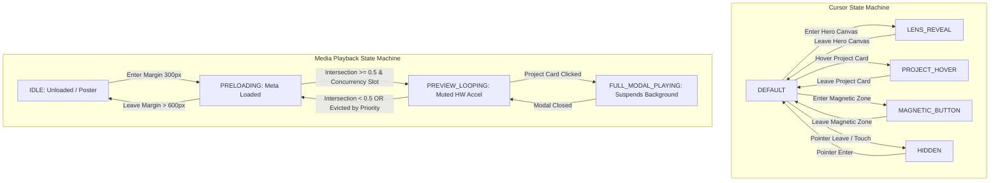
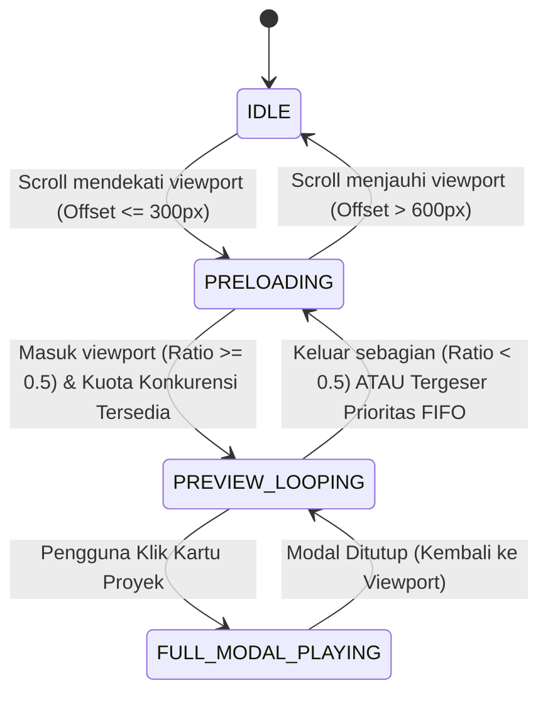
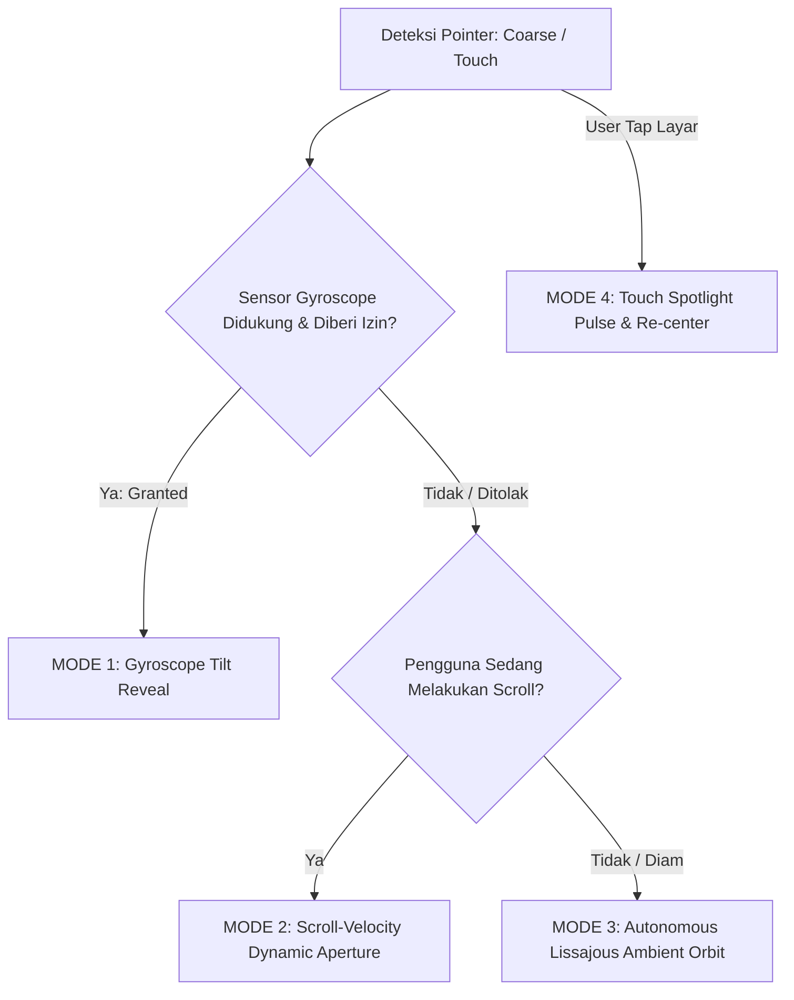

# SPEC-02: INTERACTION & SYSTEM BEHAVIOR SPECIFICATION
**Phase**: 02 — Functional & Interaction Specification  
**Status**: DRAFT (Review Pending)  
**Reference**: [01-data-architecture.md](file:///d:/WEBSITE%20PORTOFOLIO%20INDRA/specs/01-data-architecture.md)  
**Constraint**: Spesifikasi fungsional, state machine, dan algoritma perilaku interaksi murni. Tidak ada kode implementasi aplikasi di luar dokumen spesifikasi ini.

---

## 1. Arsitektur State Machine Sistem

Sistem interaksi portofolio diatur oleh dua state machine terpisah namun tersinkronisasi: **Cursor State Machine** (mengendalikan representasi visual dan interaksi penunjuk) dan **Media Playback State Machine** (mengendalikan pemanfaatan resource memori video dan GPU decoder).



---

### A. Cursor State Machine (`CursorState`)

Mendefinisikan 5 state deterministik untuk kursor interaktif kustom berbasis pointer.

| State | Ukuran / Geometri | Label / Aksen Visual | Transform & Blend Mode | Event Pemicu (*Guards*) |
| :--- | :--- | :--- | :--- | :--- |
| **`DEFAULT`** | Inner dot: 8px.<br>Outer follower ring: 36px (border 1.5px). | Dot solid, ring transparan dengan border aksen. | `mix-blend-mode: difference` atau aksen kontras; LERP interpolation (`factor = 0.15`). | Pointer aktif di area netral halaman web tanpa elemen interaktif khusus. |
| **`LENS_REVEAL`** | Lingkaran aperture membesar: 160px – 220px (responsif sesuai viewport). | Crosshair target garis tipis di tengah; koordinat badge `[X: ..., Y: ...]` dan aperture ring 1px. | Sinkron dengan koordinat kursor kustom; memotong (*clip-path*) layer tajam video hero. | Pointer bergerak masuk ke dalam bounding rect hero canvas (`#hero-showreel-container`). |
| **`PROJECT_HOVER`** | Outer ring membesar: 88px – 100px. Inner dot memudar (opacity 0). | Teks di dalam follower: `"VIEW"` atau `"EXPLORE"` (uppercase, tracking 0.1em) dengan ikon panah 45°. | Background ring semi-transparan ber-blur (`backdrop-filter: blur(8px)`), warna latar kursor kontras. | Pointer berada di atas kartu proyek galeri (`.project-card`). |
| **`MAGNETIC_BUTTON`** | Ring follower berubah bentuk mengelilingi tombol target (menyesuaikan lebar/tinggi tombol + padding 6px). | Dot melebur ke tengah tombol; glow aksen halus. | Posisi kursor ditarik secara magnetis menuju titik tengah tombol (`centerX, centerY`) dengan rumus pegas teredam. | Jarak kursor ke pusat tombol target < radius ambang magnetik (default: 32px dari tepi tombol). |
| **`HIDDEN`** | Scale 0, opacity 0. | Tidak ada. | Non-aktif (*pointer-events: none*). | Event `mouseleave` dari window browser, teks sedang diseleksi, modal video fullscreen aktif, atau pointer type = `touch`. |

#### Transisi State & Matriks Aksi Kursor

```mermaid
stateDiagram-v2
    [*] --> DEFAULT : Pointer Init Desktop
    DEFAULT --> LENS_REVEAL : ENTER_HERO_CANVAS
    LENS_REVEAL --> DEFAULT : LEAVE_HERO_CANVAS

    DEFAULT --> PROJECT_HOVER : ENTER_PROJECT_CARD
    PROJECT_HOVER --> DEFAULT : LEAVE_PROJECT_CARD

    DEFAULT --> MAGNETIC_BUTTON : ENTER_MAGNETIC_HITBOX
    MAGNETIC_BUTTON --> DEFAULT : LEAVE_MAGNETIC_HITBOX

    DEFAULT --> HIDDEN : POINTER_LEAVE_WINDOW / TOUCH_START
    LENS_REVEAL --> HIDDEN : POINTER_LEAVE_WINDOW
    PROJECT_HOVER --> HIDDEN : POINTER_LEAVE_WINDOW
    MAGNETIC_BUTTON --> HIDDEN : POINTER_LEAVE_WINDOW

    HIDDEN --> DEFAULT : POINTER_ENTER_WINDOW
```

- **Fisika Interpolasi Kursor (LERP & Spring Dynamics)**:
  - Untuk pergerakan follower biasa (`DEFAULT`, `PROJECT_HOVER`):
    $$\text{pos}_{x}(t) = \text{pos}_{x}(t-1) + (\text{target}_{x} - \text{pos}_{x}(t-1)) \times \lambda$$
    dengan $\lambda = 0.14$ (menghasilkan trailing halus tanpa lagging berat).
  - Untuk efek `MAGNETIC_BUTTON`:
    $$\vec{F}_{\text{magnetic}} = -k \cdot (\vec{P}_{\text{element}} - \vec{P}_{\text{pointer}}) - d \cdot \vec{V}_{\text{element}}$$
    dengan konstanta pegas $k = 0.35$ dan koefisien redaman $d = 0.65$. Perpindahan tombol dibatasi maksimal $\pm 14\text{px}$ pada sumbu X dan Y agar tata letak tidak rusak.

---

### B. Media Playback State Machine (`MediaPlaybackState`)

Mendefinisikan siklus hidup pemutaran video untuk efisiensi CPU/GPU memory footprint.

| State | Status Sumber Media (`src`) | Alokasi Decoder GPU | Kondisi Audio | Tindakan Sistem |
| :--- | :--- | :--- | :--- | :--- |
| **`IDLE`** | Tidak ada `src` terpasang (hanya poster WebP beresolusi teroptimasi). | 0% (Decoder dilepaskan). | Muted (N/A). | Elemen video berada di luar viewport > 600px. Tidak memakan bandwidth atau buffer memori. |
| **`PRELOADING`** | `src` terpasang, atribut `preload="metadata"`. | Minimal (hanya membaca header & keyframe pertama). | Muted. | Elemen berada dalam zona penyangga (*buffer zone*: 300px sebelum masuk viewport). Memastikan transisi instan tanpa layar hitam/stutter. |
| **`PREVIEW_LOOPING`** | Video aktif berputar (silent loop 3–7 detik). | Aktif penuh (Decoder GPU terpasang). | Wajib `muted = true`, `playsinline = true`. | Elemen terlihat di viewport dengan rasio $\ge 50\%$ dan memiliki slot kuota konkurensi aktif. |
| **`FULL_MODAL_PLAYING`** | Stream video resolusi tinggi penuh (1080p/4K) di dalam overlay modal. | Diprioritaskan 100% pada elemen modal. | Audio aktif atau kontrol volume dapat diatur oleh pengguna. | Semua video latar belakang (`PREVIEW_LOOPING` dan Hero Canvas) seketika di-`pause` untuk mengosongkan jalur decoder. |



---

## 2. Logika Cursor Lens (Dual-Layer Video Reveal)

### A. Arsitektur Desktop: Koordinat X/Y & Dynamic Masking

Hero section menggunakan tumpukan dua lapisan video identik yang berjalan secara paralel dan tersinkronisasi:
1. **Layer Dasar (Ambient Blur)**:
   - Elemen `<video id="hero-ambient-video">`.
   - Gaya: `filter: blur(28px) saturate(1.4) brightness(0.55); transform: scale(1.08);`.
   - Mengisi 100% kontainer sebagai atmosfer ambient yang dinamis dan berirama.
2. **Layer Atas (Sharp Reveal)**:
   - Elemen `<video id="hero-sharp-video">`.
   - Gaya: Resolusi tajam murni tanpa filter blur.
   - Diposisikan tepat di atas Layer Dasar dengan koordinat absolut yang identik.

```
+-------------------------------------------------------+
| HERO SHOWREEL CANVAS                                  |
|                                                       |
|  [Layer Dasar: Ambient Blur Video (Muted, Loop)]      |
|                                                       |
|              (X, Y) Kursor Lens                       |
|               .---''''''---.                          |
|             .'    SHARP     '.                        |
|            /      REVEAL      \                       |
|           |       VIDEO        |   <--- Radius R:     |
|            \     [KRISTAL]    /         160px - 200px |
|             '.              .'                        |
|               '---......---'                          |
|                                                       |
+-------------------------------------------------------+
```

#### Rumus Pemetaan Koordinat & Masking

1. **Transformasi Koordinat Relatif**:
   Untuk mencegah deviasi posisi saat halaman di-scroll atau di-resize, koordinat kursor dihitung relatif terhadap batas elemen hero:
   $$X_{\text{local}} = X_{\text{client}} - \text{rect.left}$$
   $$Y_{\text{local}} = Y_{\text{client}} - \text{rect.top}$$
   di mana $\text{rect} = \text{heroContainer.getBoundingClientRect()}$.

2. **Aplikasi Masking (High-Performance CSS / SVG Clip-Path)**:
   Layer tajam dipotong menggunakan dynamic circular mask:
   $$\text{clip-path: circle(} R \text{ px at } X_{\text{smooth}} \text{ px } Y_{\text{smooth}} \text{ px)}$$
   - Default radius kursor diam: $R_0 = 160\text{px}$.
   - **Efek Kecepatan Kursor (Dynamic Velocity Expansion)**: Radius aperture membesar secara dinamis saat kursor digerakkan cepat untuk memberikan sensasi fluiditas:
     $$V_{\text{cursor}} = \sqrt{(X_t - X_{t-1})^2 + (Y_t - Y_{t-1})^2}$$
     $$R_{\text{active}} = \min(R_0 + V_{\text{cursor}} \times 0.65, 240\text{px})$$
   - Pada tepian lingkaran, diterapkan layer SVG Mask atau pseudo-element berupa ring 1px beraksen glow (`box-shadow: inset 0 0 15px rgba(255,255,255,0.2)`) dengan 4 focal ticks (atas, kanan, bawah, kiri) untuk menegaskan estetika *precision optics / motion lens*.

3. **Sinkronisasi Frame (Dual-Video Time-Lock)**:
   - Video Sharp (`hero-sharp-video`) bertindak sebagai **Master Clock**.
   - Video Ambient (`hero-ambient-video`) bertindak sebagai **Slave**.
   - Dalam setiap siklus loop atau setiap interval 500ms, sistem memeriksa *drift* waktu:
     $$\Delta t = |t_{\text{master}} - t_{\text{slave}}|$$
   - Jika $\Delta t > 0.065\text{ detik}$ (~2 frame pada 30fps), nilai `currentTime` slave disinkronkan kembali ke master:
     $$t_{\text{slave}} = t_{\text{master}}$$

---

### B. Arsitektur Fallback untuk Touchscreen (Mobile & Tablet)

Pada perangkat sentuh tanpa kursor mouse (`@media (hover: none) and (pointer: coarse)`), paradigma kursor tidak dapat diaplikasikan karena jari menutupi layar dan ketiadaan status *hover*. Sistem menerapkan 3 lapisan fallback hierarkis:



#### 1. Mode Utama: Gyroscope-Assisted Reveal (Tilt Interaction)
- **Sensor**: Mendengarkan event `deviceorientation` (`beta` = kemiringan depan/belakang $\pm 180^\circ$, `gamma` = kemiringan kiri/kanan $\pm 90^\circ$).
- **Normalisasi Sudut ke Viewport**:
  $$X_{\text{gyro}} = \text{clamp}\left(\frac{\gamma - (-30^\circ)}{60^\circ}, 0, 1\right) \times \text{width}$$
  $$Y_{\text{gyro}} = \text{clamp}\left(\frac{\beta - 15^\circ}{50^\circ}, 0, 1\right) \times \text{height}$$
- **Respons Fisik**: Saat pengguna memiringkan smartphone ke kiri/kanan atau atas/bawah, titik aperture tajam meluncur lembut ke arah kemiringan, mengekspos detail video secara interaktif tanpa menyentuh layar.
- **Izin Privasi (iOS 13+)**: Jika sistem membutuhkan `DeviceOrientationEvent.requestPermission()`, UI menampilkan ikon minimalis `⟲ Gyro Mode` yang dapat diaktifkan secara eksplisit oleh pengguna dengan 1 ketukan.

#### 2. Mode Kedua: Autonomous Orbit (Lissajous Curve Loop)
Jika gyroscope tidak aktif atau izin ditolak:
- Lensa bergerak secara otonom mengikuti kurva harmonik halus (Lissajous figure):
  $$X_{\text{orbit}}(t) = X_{\text{center}} + A \cdot \sin(\omega_x \cdot t + \delta)$$
  $$Y_{\text{orbit}}(t) = Y_{\text{center}} + B \cdot \sin(\omega_y \cdot t)$$
  dengan parameter $\omega_x = 0.0012$, $\omega_y = 0.0018$, amplitudo $A = 0.35 \times \text{width}$, $B = 0.25 \times \text{height}$.
- Lensa bergerak perlahan melintasi area fokus video secara sinematik seolah-olah kamera showreel sedang melakukan spotlight scan.

#### 3. Mode Ketiga: Touch Spotlight Pulse
- Jika pengguna menyentuh area hero canvas, koordinat lensa seketika berpindah (*snap with dampening*) ke titik sentuhan `(touchX, touchY)`.
- Radius aperture mengembang sebesar $1.3\times$ sesaat (pulse 300ms) memberikan konfirmasi visual bahwa titik tersebut terfokus, kemudian kembali mengikuti mode orbit setelah jari diangkat selama 2.5 detik tanpa interaksi.

---

## 3. Aturan Manajemen Memori Video & Performa GPU

Untuk menjaga performa 60 FPS stabil pada perangkat low-end maupun laptop dengan keterbatasan GPU decoder, arsitektur menerapkan kebijakan kuota memori (*Video Concurrency Budget*) yang ketat.

### A. Kebijakan Kuota Konkurensi (*Concurrency Budget*)

| Platform / Kategori Perangkat | Batas Maksimum Video Berputar Bersamaan (`MaxActiveStreams`) | Strategi Prioritas Eviction |
| :--- | :---: | :--- |
| **Desktop / Laptop** | **2 Video Aktif** | **Center-Proximity Distance**: Video yang paling dekat dengan titik tengah vertikal layar diprioritaskan. |
| **Mobile / Tablet** | **1 Video Aktif** | **Strict Single Stream**: Hanya 1 video yang boleh berputar. Video lain wajib di-pause atau di-fallback ke poster WebP. |
| **Low Power Mode / Reduced Motion** | **0 Video Otomatis** | Pause semua video; tampilkan poster statis resolusi tinggi dan sediakan tombol play manual. |

### B. Algoritma IntersectionObserver & Antrean Prioritas (FIFO / Center-Proximity)

Setiap elemen video di galeri karya dikontrol melalui satu observer global dengan zona margin:

```
+----------------------------------------------------------+
| ZONA A: Jauh di Luar Viewport (> 600px)                  |
| State: IDLE -> src dikosongkan / video unmounted        |
+----------------------------------------------------------+
| ZONA B: Penyangga (Buffer Offset: 300px sebelum Viewport)|
| State: PRELOADING -> preload="metadata" dipasang         |
+==========================================================+
|                                                          |
| VIEWPORT AKTIF                                           |
| Jarak ke pusat layar: d = |CardCenterY - ViewportCenterY||
|                                                          |
| [Kartu Proyek 1] -> d = 40px  (PREVIEW_LOOPING #1)      |
| [Kartu Proyek 2] -> d = 180px (PREVIEW_LOOPING #2)      |
| [Kartu Proyek 3] -> d = 420px (PAUSED / PRELOADED)       |
|                                                          |
+==========================================================+
| ZONA B: Penyangga Bawah (300px)                          |
+----------------------------------------------------------+
| ZONA A: Jauh di Bawah (> 600px)                          |
+----------------------------------------------------------+
```

#### Logika Evaluasi Kuota:
1. Saat event scroll memicu perubahan intersection:
   - Ambil seluruh elemen dengan status intersection $\text{ratio} \ge 0.5$.
2. Jika jumlah elemen terlihat $> \text{MaxActiveStreams}$:
   - Hitung jarak vertikal dari pusat elemen kartu ke pusat viewport:
     $$d_i = \left| \left(y_{\text{card, top}} + \frac{h_{\text{card}}}{2}\right) - \left(y_{\text{viewport, top}} + \frac{h_{\text{viewport}}}{2}\right) \right|$$
   - Urutkan elemen berdasarkan $d_i$ menaik (*ascending*).
   - Elemen ke-1 hingga ke-$N$ ($N = \text{MaxActiveStreams}$) dialihkan ke status `PREVIEW_LOOPING` (panggil `.play()`).
   - Elemen ke-$(N+1)$ dan seterusnya dialihkan ke status `PRELOADING` (panggil `.pause()` dan tahan frame awal).

---

### C. Alur Transisi Pembukaan Detail Proyek (Modal Showcase Lifecycle)

Ketika pengguna mengklik salah satu kartu proyek untuk menyaksikan video penuh:

```mermaid
sequenceDiagram
    autonumber
    actor User as Pengguna
    participant Card as Project Card UI
    participant Manager as Media Playback Manager
    participant Hero as Hero Showreel Video
    participant Modal as Project Detail Modal (Full Video)

    User->>Card: Klik Kartu Proyek
    Card->>Manager: REQUEST_FULL_SHOWCASE(projectId)
    
    rect rgb(30, 30, 45)
        Note over Manager,Hero: Tahap 1: Suspensi Latar Belakang (Bebaskan GPU)
        Manager->>Hero: Pause Ambient & Sharp Video
        Manager->>Card: Pause Semua Preview Looping di Grid
        Manager->>Manager: Kunci Status = FULL_MODAL_PLAYING
    end

    rect rgb(20, 45, 30)
        Note over Card,Modal: Tahap 2: Animasi Ekspansi Geometri (FLIP)
        Card->>Modal: Clone Bounding Box & Poster
        Modal->>Modal: Transisi Membesar ke Posisi Tengah Layar (Duration: 380ms)
    end

    rect rgb(45, 30, 30)
        Note over Modal: Tahap 3: Pemasangan Stream Resolusi Tinggi
        Modal->>Modal: Pasang Full Video Stream (YouTube / Vimeo / CDN MP4)
        Modal->>Modal: Play Video & Fade-in Audio (0.3s Exponential Curve)
    end

    User->>Modal: Klik Tutup Modal / Tekan Tombol ESC
    
    rect rgb(30, 30, 45)
        Note over Modal,Manager: Tahap 4: Restorasi Sistem
        Modal->>Modal: Stop Video, Kosongkan Buffer Memory
        Modal->>Modal: Animasi Mengecil Kembali ke Kartu
        Manager->>Manager: Lepas Status FULL_MODAL_PLAYING
        Manager->>Hero: Resume Hero Video (Jika masih di Viewport)
        Manager->>Card: Jalankan Ulang Evaluasi IntersectionObserver
    end
```



#### Rincian Transisi & Keselamatan Memori:
1. **Immediate Decoupling**: Sebelum modal selesai menganimasikan tampilannya, semua video di halaman web langsung dieksekusi `.pause()`. Hal ini mencegah drop frame animasi akibat perebutan *hardware video decode pipelines*.
2. **Audio Handshake**:
   - Video pratinjau kartu bersifat hening (*silent* / `muted = true`).
   - Video modal memiliki audio. Sistem mencegah audio 'meletup' dengan menerapkan volume envelope:
     $$\text{Volume}(t) = \left(\frac{t}{T_{\text{fade}}}\right)^2 \quad \text{untuk } t \le 300\text{ms}$$
3. **Pembersihan Bersih (Garbage Collection Trigger)**:
   - Saat modal ditutup, `src` dari elemen video modal diubah menjadi string kosong (`video.src = ""`) dan elemen dieksekusi `.load()`. Ini memaksa browser melepaskan buffer RAM dan memori VRAM yang dialokasikan untuk video resolusi tinggi tersebut.
