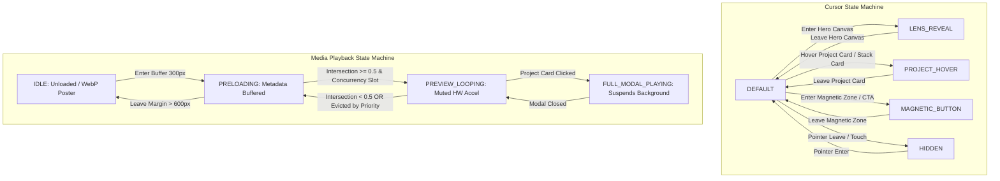
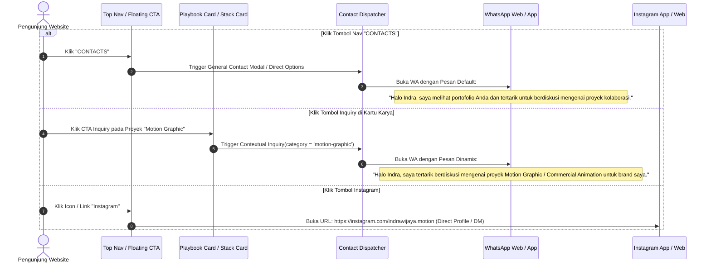

# SPEC-02: INTERACTION & SYSTEM BEHAVIOR SPECIFICATION
**Project**: Portfolio Website Indra Wijaya — Creative Motion Designer & AI Development  
**Concept**: Interactive Dark Minimalist with Cursor Lens / Refraction & Dynamic Showreel (Inspired by Purrweb Designer Portfolio)  
**Phase**: 02 — Functional & Interaction Specification  
**Status**: APPROVED & SYNCHRONIZED  
**Reference**: [01-data-architecture.md](file:///d:/WEBSITE%20PORTOFOLIO%20INDRA/specs/01-data-architecture.md)  
**Constraint**: Spesifikasi fungsional, state machine, dan algoritma perilaku interaksi murni. DILARANG menulis kode implementasi atau membuat file di luar direktori `/specs/`.

---

## 1. Arsitektur State Machine Sistem

Sistem interaksi portofolio diatur oleh dua state machine independen namun tersinkronisasi: **Cursor State Machine** (mengendalikan representasi visual pointer dan interaksi optik) dan **Media Playback State Machine** (mengendalikan alokasi memori video, GPU hardware decoder, dan transisi modal).



---

### A. Cursor State Machine (`CursorState`)

Mendefinisikan 5 state deterministik untuk kursor interaktif kustom berbasis pointer.

| State | Geometri / Ukuran | Label / Aksen Visual | Transform & Blend Mode | Event Pemicu (*Guards*) |
| :--- | :--- | :--- | :--- | :--- |
| **`DEFAULT`** | Inner dot: 8px.<br>Outer follower ring: 36px (border 1.5px). | Dot solid putih, ring transparan border aksen. | `mix-blend-mode: difference`; LERP interpolation ($\lambda = 0.14$). | Pointer aktif di area netral halaman tanpa elemen interaktif khusus. |
| **`LENS_REVEAL`** | Lingkaran aperture membesar: 160px – 240px (responsif sesuai kecepatan gerak kursor). | Ticks optik konsentris SVG di 4 kuadran; badge koordinat `[X: ..., Y: ...]`. | Memotong (*clip-path*) layer video tajam Hero; LERP halus ($\lambda = 0.18$). | Pointer memasuki batas kontainer Hero Showreel (`#hero-showreel-container`). |
| **`PROJECT_HOVER`** | Follower ring membesar ke diameter 88px – 100px. Inner dot memudar (`opacity: 0`). | Badge teks di dalam follower:<br>• `"VIEW"` (untuk kartu *Motion Graphic*)<br>• `"EXPLORE"` (untuk *Graphic Design* & *AI Dev*)<br>• `"SHUFFLE"` (saat hover kartu tumpukan belakang). | Latar ring ber-blur (`backdrop-filter: blur(8px)`), warna latar kontras tinggi. | Pointer berada di atas kartu karya Playbook (`.project-card`) atau Stacked Cards Deck. |
| **`MAGNETIC_BUTTON`** | Ring follower berubah bentuk mengelilingi tombol target (lebar/tinggi tombol + padding 6px). | Dot melebur ke pusat tombol; aksen glow halus. | Posisi ditarik secara magnetis ke titik tengah tombol dengan rumus pegas teredam (*damped spring*). | Jarak pointer ke pusat tombol (CTA WhatsApp, IG, Navigasi) < radius ambang magnetik (default: 32px dari tepi tombol). |
| **`HIDDEN`** | Skala 0, `opacity: 0`. | Tidak ada. | Non-aktif (*pointer-events: none*). | Event `mouseleave` dari window browser, modal video fullscreen aktif, atau pointer type = `touch`. |

---

### B. Media Playback State Machine (`MediaPlaybackState`)

Mendefinisikan siklus hidup pemutaran media adaptif (video loop untuk *Motion Graphic* serta gambar resolusi tinggi untuk *Graphic Design* dan *AI Development*) guna mengoptimalkan konsumsi memori dan daya baterai.

| State | Status Sumber Media (`src`) | Alokasi Decoder GPU | Kondisi Audio | Tindakan Sistem |
| :--- | :--- | :--- | :--- | :--- |
| **`IDLE`** | `src` belum dipasang (hanya poster WebP berukuran teroptimasi). | 0% (Decoder dilepaskan). | Muted (N/A). | Elemen media berada di luar viewport > 600px. Tidak memakan bandwidth atau buffer RAM. |
| **`PRELOADING`** | `src` terpasang, atribut `preload="metadata"`. | Minimal (hanya membaca header & keyframe pertama). | Muted. | Elemen berada dalam zona penyangga (*buffer zone*: 300px sebelum masuk viewport). Memastikan transisi instan tanpa layar hitam/flicker. |
| **`PREVIEW_LOOPING`** | Video aktif berputar (silent loop). | Aktif penuh (Hardware decoder teralokasi). | Wajib `muted = true`, `playsinline = true`. | Elemen terlihat di viewport dengan rasio $\ge 50\%$ dan memiliki kuota konkurensi aktif. Khusus kategori gambar (*Graphic Design*), state ini merender high-res still image tanpa alokasi decoder video. |
| **`FULL_MODAL_PLAYING`** | Stream video resolusi tinggi penuh (1080p/4K) di dalam overlay modal showcase. | Diprioritaskan 100% pada elemen modal. | Audio aktif atau kontrol volume dapat diatur oleh pengunjung. | Semua video latar belakang (`PREVIEW_LOOPING` dan Hero Canvas) seketika di-`pause` untuk mengosongkan jalur decoder. |

---

## 2. Logika Cursor Lens & Stacked Cards Deck (Purrweb Style)

### A. Arsitektur Desktop Cursor Lens (Dual-Layer Video Reveal)

Hero section menggunakan tumpukan dua lapisan video sinkron:
1. **Layer Dasar (Ambient Blur)**:
   - Elemen `<video id="hero-ambient-video">`.
   - Gaya visual: `filter: blur(28px) saturate(1.4) brightness(0.55); transform: scale(1.08);`.
   - Mengisi 100% area hero sebagai atmosfer ambient yang berdenyut sinematik.
2. **Layer Atas (Sharp Reveal)**:
   - Elemen `<video id="hero-sharp-video">`.
   - Gaya visual: Resolusi tajam murni tanpa filter blur, frame rate terkunci.
   - Dipotong secara dinamis menggunakan CSS circular clip-path berpusat pada kursor pengguna.

#### Rumus Pemetaan Koordinat & Masking:
1. **Transformasi Koordinat Relatif**:
   $$X_{\text{local}} = X_{\text{client}} - \text{rect.left}$$
   $$Y_{\text{local}} = Y_{\text{client}} - \text{rect.top}$$
   di mana $\text{rect} = \text{heroContainer.getBoundingClientRect()}$.

2. **Aplikasi Masking (High-Performance CSS Clip-Path)**:
   $$\text{clip-path: circle(} R \text{ px at } X_{\text{smooth}} \text{ px } Y_{\text{smooth}} \text{ px)}$$
   - Default radius kursor diam: $R_0 = 160\text{px}$.
   - **Dynamic Velocity Expansion**: Radius aperture mengembang secara dinamis saat kursor digerakkan cepat:
     $$V_{\text{cursor}} = \sqrt{(X_t - X_{t-1})^2 + (Y_t - Y_{t-1})^2}$$
     $$R_{\text{active}} = \min(R_0 + V_{\text{cursor}} \times 0.65, 240\text{px})$$

---

### B. Interaksi Tumpukan 3 Kartu Hero (Bottom-Right Stacked Cards Deck)

Di sudut kanan bawah Hero Section, terdapat tumpukan 3 kartu bertingkat (*Stacked Cards Deck*) yang merepresentasikan 3 kategori karya utama:

```
+-------------------------------------------------------------+
| HERO SHOWREEL CANVAS                                        |
|                                                             |
|  "Creative motion designer"                                 |
|                                                             |
|  [Metadata Kiri Bawah]             [STACKED CARDS DECK]     |
|  - MOTION GRAPHIC / GD / AI           +-------------------+ |
|  - AVAILABLE FOR FREELANCE            | 3. AI DEVELOPMENT | |
|  - INDONESIA (REMOTE)             +---+-------------------+ |
|                                   | 2. GRAPHIC DESIGN     | |
|                               +---+-------------------+   | |
|                               | 1. MOTION GRAPHIC     |   | |
|                               | [Sharp Video Loop]    |   | |
|                               +-----------------------+   | |
+-------------------------------------------------------------+
```

#### Spesifikasi Tingkatan Tumpukan (Depth Hierarchy):

| Kartu & Kategori | Posisi Tumpukan | Skala & Offset | Efek Visual | Status Media |
| :--- | :--- | :--- | :--- | :--- |
| **1. `MOTION GRAPHIC`** | Terdepan (`z-index: 3`) | `scale(1.00)`, `translateY(0px)` | Tajam penuh, border kontras `#38383e`, bayangan lembut. | Video loop aktif (silent 3–6s, teroptimasi). |
| **2. `GRAPHIC DESIGN`** | Tengah (`z-index: 2`) | `scale(0.94)`, `translateY(-14px)` | `filter: blur(4px) brightness(0.75)`, `opacity: 0.85`. | Poster still preview (WebP). |
| **3. `AI DEVELOPMENT`** | Belakang (`z-index: 1`) | `scale(0.88)`, `translateY(-28px)` | `filter: blur(8px) brightness(0.55)`, `opacity: 0.65`. | Poster still preview (WebP). |

#### Logika Interaksi Deck Shuffle & Navigasi:
1. **Hover pada Kartu Belakang/Tengah**:
   - Kartu yang di-hover sedikit terangkat (`translateY(-6px)` tambahan) dan kursor berubah ke state `PROJECT_HOVER` dengan label `"SHUFFLE"`.
2. **Klik pada Kartu Belakang/Tengah (Deck Shuffle)**:
   - Animasi transisi GSAP spring ($0.45\text{s}$, `ease: "power3.out"`) menukar urutan tumpukan. Kartu yang diklik meluncur keluar sedikit ke samping lalu mendarat di posisi terdepan (`z-index: 3`, blur hilang, scale 1.0).
   - Kartu yang sebelumnya di depan mundur ke posisi tengah atau belakang.
3. **Klik pada Kartu Terdepan (Direct Playbook Filter)**:
   - Memicu smooth scroll langsung ke bagian **The Playbook (Works)**, dan secara otomatis menyetel tab filter aktif ke kategori kartu tersebut (misal: langsung memfilter hanya karya *Motion Graphic*).

---

### C. Arsitektur Fallback untuk Touchscreen (Mobile & Tablet)

Pada perangkat sentuh tanpa kursor mouse (`@media (hover: none) and (pointer: coarse)`), sistem menerapkan 3 lapisan fallback hierarkis:
1. **Mode 1 (Gyroscope Tilt Reveal)**: Membaca sensor kemiringan ponsel (`gamma` dan `beta` via `DeviceOrientationEvent`) untuk mengarahkan fokus lingkaran lensa secara organik saat pengguna memiringkan perangkat.
2. **Mode 2 (Autonomous Lissajous Orbit)**: Jika sensor orientasi tidak didukung atau izin ditolak, lensa bergerak perlahan mengikuti kurva Lissajous sinematik di sekitar area fokus.
3. **Mode 3 (Touch Spotlight Pulse)**: Sentuhan jari pada layar Hero memindahkan aperture seketika ke titik sentuh dengan efek denyut pulse $1.3\times$ (300ms).

---

## 3. Logika Konversi Cepat: Direct WhatsApp & Instagram

Untuk mengeliminasi friksi formulir email tradisional, seluruh tombol kontak dan CTA dirancang untuk memicu aksi langsung ke WhatsApp dan Instagram dengan data kontekstual otomatis:



#### Aturan Pemformatan Tautan WhatsApp Dinamis:
- Format URL standar:
  $$\text{URL} = \text{https://wa.me/} + \text{phoneNumber} + \text{?text=} + \text{encodeURIComponent}(\text{message})$$
- Jika kategori aktif adalah `motion-graphic`:
  `"Halo Indra, saya tertarik berdiskusi mengenai proyek Motion Graphic / Commercial Animation untuk brand saya."`
- Jika kategori aktif adalah `graphic-design`:
  `"Halo Indra, saya tertarik berdiskusi mengenai kebutuhan Visual Identity / Graphic Design proyek kami."`
- Jika kategori aktif adalah `ai-development`:
  `"Halo Indra, saya tertarik berdiskusi mengenai eksplorasi AI Creative Pipeline & Visual Generation untuk campaign kami."`

---

## 4. Aturan Manajemen Memori Video & Performa GPU

1. **Batas Maksimal Video Berputar Bersamaan (`MaxActiveStreams`)**:
   - **Desktop**: Maksimal **2 video aktif** berputar bersamaan.
   - **Mobile**: Maksimal **1 video aktif**.
   - **Graphic Design & Still Image**: Menggunakan elemen `` / WebP tanpa memakan slot decoder video GPU.
2. **Evaluasi Prioritas Jarak ke Pusat Layar (*Center-Proximity Distance*)**:
   - Elemen dengan jarak vertikal terdekat ke pusat layar viewport ($|y_{\text{center}} - y_{\text{viewport}}|$) diprioritaskan untuk status `PREVIEW_LOOPING`. Elemen lainnya otomatis di-`pause` dan ditahan di frame awal poster.
3. **Transisi Modal Detail Proyek (FLIP Transition)**:
   - Saat modal dibuka: Seluruh video latar belakang seketika dieksekusi `.pause()`.
   - Animasi ekspansi geometri kartu ke layar penuh berlangsung mulus tanpa frame drop (380ms).
   - Audio video modal melakukan *fade-in* eksponensial (300ms).
   - Saat modal ditutup: Video modal dihancurkan (`video.src = ""`), memori buffer VRAM dibebaskan, dan sistem memanggil re-evaluasi observer untuk memutar kembali kartu yang berada di tengah layar.
