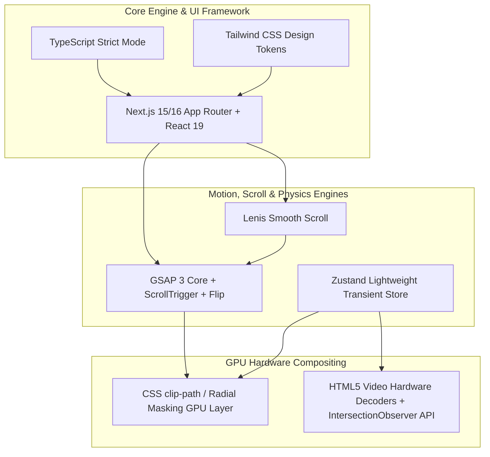
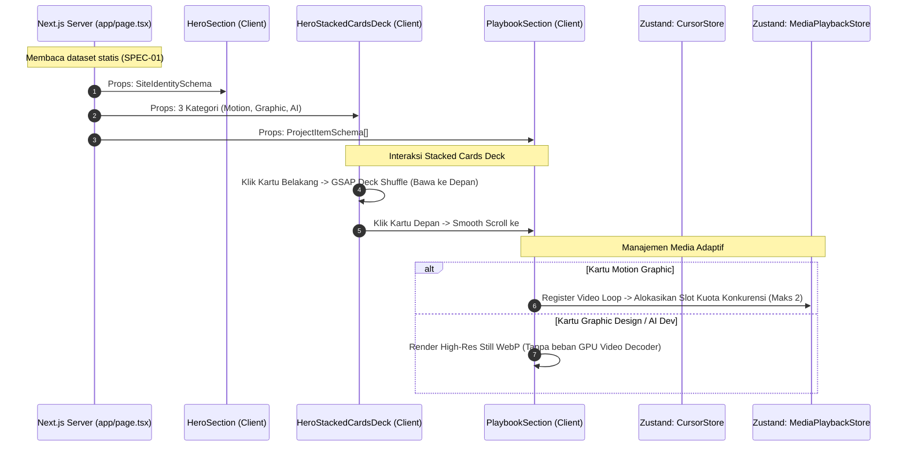

# SPEC-03: TECHNICAL ARCHITECTURE & ASSET PIPELINE
**Project**: Portfolio Website Indra Wijaya — Creative Motion Designer & AI Development  
**Concept**: Interactive Dark Minimalist with Cursor Lens / Refraction & Dynamic Showreel (Inspired by Purrweb Designer Portfolio)  
**Phase**: 03 — Technical Architecture & Asset Pipeline  
**Status**: APPROVED & SYNCHRONIZED  
**References**: [01-data-architecture.md](file:///d:/WEBSITE%20PORTOFOLIO%20INDRA/specs/01-data-architecture.md) & [02-interaction-behavior.md](file:///d:/WEBSITE%20PORTOFOLIO%20INDRA/specs/02-interaction-behavior.md)  
**Constraint**: Spesifikasi teknis arsitektur perangkat lunak, pohon komponen, alur data, dan pipeline aset murni. DILARANG membuat scaffolding atau kode implementasi aplikasi di luar direktori `/specs/`.

---

## 1. Tech Stack & Library Lock

Pemilihan stack dirancang untuk memaksimalkan performa grafis (60–120 FPS tanpa frame drop), meminimalkan ukuran JavaScript runtime di browser (*zero hydration bottleneck*), serta menjamin akurasi fisika interaksi kursor lensa, *stacked cards deck*, dan manajemen memori video.



### Rincian Komponen Teknologi & Rationale Pemilihan:

| Layer Teknologi | Solusi Terpilih | Versi / Library | Rationale & Alasan Teknis |
| :--- | :--- | :--- | :--- |
| **Framework & SSR** | **Next.js (App Router)** | `15.x / 16.x` (React 19) | Mendukung *React Server Components (RSC)* sehingga data portofolio (karya, bio, teks) dirender statis di server tanpa beban runtime JS. LCP (*Largest Contentful Paint*) tercapai < 0.8s. Client boundary hanya diterapkan pada kanvas interaktif, kursor, dan *stacked cards deck*. |
| **Bahasa Pemrograman** | **TypeScript** | `5.x (Strict)` | Memastikan seluruh kontrak data dari `SPEC-01` dan payload event `SPEC-02` terlindungi secara *type-safe* tanpa kemungkinan `undefined` runtime error. |
| **Styling & Design Tokens** | **Tailwind CSS + CSS Variables** | `Tailwind CSS` | Menghilangkan beban CSS runtime-in-JS. Palet warna dark luxury (`#080808`, `#0f0f11`, `#1a1a20`, `#202024`, aksen monokrom kontras) didefinisikan sebagai CSS custom properties native untuk rendering instan. |
| **Smooth Scrolling** | **Lenis Scroll** | `lenis` | Scroll inertia berbasis pegas fisik berbobot ringan (<3KB). Tidak membajak (*hijack*) native event browser, ramah aksesibilitas keyboard/touch, dan disinkronkan langsung ke ticker GSAP. |
| **Animasi & Timeline** | **GSAP (GreenSock)** | `gsap 3.x` | Mesin tweening industri paling stabil untuk 60/120 FPS frame synchronization. Digunakan untuk *stacked cards shuffle*, scroll-pinned hero, FLIP shared-element modal transition, dan kinetic typography loop. |
| **State Kursor & Media** | **Zustand** | `zustand` | Global store ultra-ringan (<1KB). Mendukung **transient subscriptions** (pembaruan koordinat kursor X/Y, kartu deck aktif, dan antrean media langsung memanipulasi DOM ref tanpa memicu re-render siklus React yang berat). |
| **Masking Lensa Kursor** | **Native CSS `clip-path` + GPU Transform** | Native Web Platform | Menghindari penggunaan engine 3D berat (Three.js/WebGL) yang memakan bundle >600KB. CSS `clip-path: circle(...)` yang diakselerasi GPU (`will-change: clip-path`) berjalan pada 60 FPS murni dengan konsumsi baterai sangat hemat. |
| **Ikonografi & Font** | **Lucide React + `next/font`** | `lucide-react` | Ikon SVG berbasis tree-shaking otomatis. Font display (*Syne* / *Clash Display*) dan font UI (*Inter*) dimuat secara zero-layout-shift via `next/font`. |

---

## 2. Component Tree & Data Flow Architecture

### A. Hirarki Komponen Visual (Component Tree)

```
RootLayout (app/layout.tsx)
│
├── SmoothScrollProvider (Lenis context & RAF Ticker)
│   │
│   ├── CustomCursorPortal (Zustand: CursorState)
│   │   ├── CursorInnerDot (8px solid white)
│   │   ├── CursorFollowerRing (36px -> 180px aperture ring)
│   │   ├── LensCoordinatesBadge (X, Y telemetry live badge)
│   │   └── HoverActionLabel ("VIEW" / "EXPLORE" / "SHUFFLE")
│   │
│   ├── TopNavBar (Header Global)
│   │   ├── Wordmark ("INDRA WIJAYA")
│   │   ├── NavigationLinks (PLAYBOOK, SOCIALS, CONTACTS)
│   │   └── LiveAvailabilityIndicator (Glowing green pulse pill)
│   │
│   ├── MainContent (app/page.tsx - Server Component)
│   │   │
│   │   ├── HeroSection (ShowreelHero & Kinetic Canvas)
│   │   │   ├── KineticHeadline (Prefix: "Creative " + Dynamic Word + Suffix: " designer")
│   │   │   ├── HeroDualVideoCanvas (Client Interactive Canvas)
│   │   │   │   ├── AmbientBlurVideo (Layer 0: Blur 28px, Muted Loop)
│   │   │   │   ├── SharpRevealVideo (Layer 1: Crisp 1080p, clip-path mask)
│   │   │   │   ├── LensApertureOverlay (SVG Precision Ticks & Border Ring)
│   │   │   │   └── GyroscopeController (Mobile tilt / Lissajous fallback)
│   │   │   │
│   │   │   ├── MetadataBar (Kiri Bawah: Specializations, Availability, Location)
│   │   │   │
│   │   │   └── HeroStackedCardsDeck (Kanan Bawah: 3 Kategori Bertingkat)
│   │   │       ├── CardMotionGraphic (Terdepan: z-3, scale 1.0, sharp silent video loop)
│   │   │       ├── CardGraphicDesign (Tengah: z-2, scale 0.94, blur 4px)
│   │   │       └── CardAiDevelopment (Belakang: z-1, scale 0.88, blur 8px)
│   │   │
│   │   ├── PlaybookSection (Katalog Karya & Filter Kategori)
│   │   │   ├── SectionHeading ("THE PLAYBOOK (WORKS)")
│   │   │   ├── CategoryFilterTabs (MOTION GRAPHIC, GRAPHIC DESIGN, AI DEVELOPMENT, ALL)
│   │   │   └── ProjectResponsiveGrid (Multi-ratio: 16:9, 9:16, 1:1)
│   │   │       └── ProjectCard [x N] (Adaptive Media & Observer Controlled)
│   │   │           ├── AdaptiveMediaContainer
│   │   │           │   ├── VideoPreviewPlayer (Khusus Motion Graphic: Silent loop 3-6s)
│   │   │           │   └── HighResStillViewer (Khusus Graphic Design / AI Dev)
│   │   │           ├── ProjectMetaBar (Title, Client/Context, Year)
│   │   │           ├── ToolBadgesList (After Effects, Premiere, Photoshop, Illustrator, Midjourney, ComfyUI)
│   │   │           └── DirectWhatsAppButton (Pesan kontekstual otomatis per kategori)
│   │   │
│   │   └── DirectContactFooter (Footer & Konversi Cepat)
│   │       ├── ConversionCardsGrid
│   │       │   ├── WhatsAppDirectCard (Nomor WA + Pre-filled dynamic chat)
│   │       │   └── InstagramDirectCard (@indrawijaya.motion + DM link)
│   │       ├── SocialLinksList (Behance, Vimeo, LinkedIn, YouTube)
│   │       └── CopyrightBar ("(C) 2026 INDRA WIJAYA. ALL RIGHTS RESERVED.")
│   │
│   └── ProjectDetailModal (Portal: Fullscreen FLIP Transition)
│       ├── BackdropBlurOverlay
│       ├── ExpandedMediaViewer (Full HD Video Stream dengan Audio Controls / High-res Still Artwork)
│       ├── CaseStudyBreakdown (Challenge, Solution, Creative Pipeline Breakdown)
│       └── CloseModalButton (ESC trigger / Memory GC release)
```

---

### B. Aliran Data & State Handshake (Data Flow Diagram)



---

## 3. Video & Asset Pipeline Specification

Agar halaman mempertahankan **60–120 FPS tanpa micro-stutter** saat video dimuat dan diputar bersamaan, seluruh aset video dan gambar harus memenuhi standar kompresi dan encoding berikut.

### A. Matriks Spesifikasi Encoding Video & Gambar

| Tipe Aset Media | Format & Kontainer | Codec | Resolusi Maksimal | Framerate | Target Bitrate | Batas Ukuran File | Konfigurasi Audio |
| :--- | :--- | :--- | :--- | :---: | :--- | :--- | :--- |
| **Hero Ambient Blur (Layer 0)** | WebM (Primary)<br>MP4 (Fallback) | VP9 (WebM)<br>H.264 High (MP4) | 1920 × 1080 (Desktop)<br>1280 × 720 (Mobile) | 30 FPS | 1.1 Mbps – 1.4 Mbps | **Maks. 3.5 MB** (durasi 10–14s) | **WAJIB DIHAPUS (No Audio Track)** |
| **Hero Sharp Reveal (Layer 1)** | WebM (Primary)<br>MP4 (Fallback) | VP9 (WebM)<br>H.264 High (MP4) | 1920 × 1080 | 30 FPS *(frame sync)* | 2.0 Mbps – 2.5 Mbps | **Maks. 5.5 MB** (durasi 10–14s) | **WAJIB DIHAPUS (No Audio Track)** |
| **Hero Deck Front Card (Motion Graphic)** | WebM / MP4 | VP9 / H.264 | 640 × 360 (16:9) | 30 FPS | 600 kbps | **Maks. 800 KB** (durasi 3–5s) | **WAJIB DIHAPUS (No Audio Track)** |
| **Project Card Preview Loop (Motion Graphic)** | WebM (Primary)<br>MP4 (Fallback) | VP9 (WebM)<br>H.264 Constrained | 1280 × 720 (16:9)<br>720 × 1280 (9:16) | 30 FPS | 700 kbps – 1.0 Mbps | **Maks. 1.2 MB** per item (durasi 3–6s) | **WAJIB DIHAPUS (No Audio Track)** |
| **Project High-Res Still (Graphic Design & AI Dev)** | WebP (Primary)<br>AVIF | Lossless / Lossy Q82 | 1920 × 1920 (1:1)<br>1920 × 1080 (16:9) | N/A | N/A | **Maks. 250 KB** | N/A |
| **Full Project Showcase Video** | Embedded CDN / Stream HLS | H.264 / AV1 / HLS | 1080p / 4K Adaptive | 60 FPS | Adaptive Stream | Streaming CDN (Vimeo/Cloudflare/YouTube) | Stereo AAC 192 kbps (Fade-in enabled) |

> [!IMPORTANT]
> **Aturan Penghapusan Audio Track pada Preview Loops:**  
> Seluruh video loop latar belakang (`Hero`, `Deck Card`, dan `Project Card Previews`) **wajib di-strip track audionya pada level kontainer file** (bukan sekadar diatur `muted` di tag HTML). Keberadaan track audio kosong tetap memaksa browser menginisialisasi audio decoding thread yang menyerap CPU cycle dan memperlambat autoplay policy.

### B. Formula Batch Transcoding FFmpeg (Standardized Asset Pipeline)

```bash
# 1. Menghasilkan Video WebM (VP9, Muted / No Audio, Dua-Pass VBR)
ffmpeg -i input_master.mov -an -c:v libvpx-vp9 -b:v 1200k -minrate 600k -maxrate 1500k \
  -crf 28 -quality good -speed 2 -threads 8 -pix_fmt yuv420p output_preview.webm

# 2. Menghasilkan Video Fallback MP4 (H.264, No Audio, Faststart untuk Progressive Streaming)
ffmpeg -i input_master.mov -an -c:v libx264 -preset slow -crf 23 -maxrate 1400k -bufsize 2800k \
  -pix_fmt yuv420p -movflags +faststart output_preview.mp4

# 3. Menghasilkan Thumbnail Poster WebP (Keyframe Frame 0, Kualitas Tajam Teroptimasi)
ffmpeg -ss 00:00:00 -i input_master.mov -vframes 1 -q:v 80 -pix_fmt yuv420p output_poster.webp
```

---

## 4. Folder Structure Blueprint

Struktur direktori dirancang dengan pendekatan modular, memisahkan domain data murni, state management atomik, animasi canvas, dan antarmuka komponen.

```
WEBSITE PORTOFOLIO INDRA/
│
├── specs/                            # Living Architectural Specifications (SDD)
│   ├── 01-data-architecture.md       # Fase 1: Content contracts & schema
│   ├── 02-interaction-behavior.md    # Fase 2: State machines, lens & stacked cards
│   ├── 03-technical-architecture.md   # Fase 3: Tech stack, component tree & assets
│   └── TASKS.md                      # Fase 4: Implementation roadmap
│
├── public/                           # Static production assets
│   ├── videos/
│   │   ├── hero/
│   │   │   ├── hero-ambient-blur.mp4
│   │   │   └── hero-sharp-reveal.mp4
│   │   └── projects/
│   │       ├── hyperdrive-preview.mp4
│   │       ├── neural-genesis-preview.mp4
│   │       └── ...
│   ├── posters/                      # WebP low-latency fallback posters
│   └── images/                       # High-res stills untuk Graphic Design & AI Dev
│
├── src/
│   ├── app/                          # Next.js App Router root
│   │   ├── layout.tsx                # Root layout with Lenis & Cursor portal
│   │   ├── page.tsx                  # Server Component: main showcase entry
│   │   └── globals.css               # Design tokens & CSS variables
│   │
│   ├── components/
│   │   ├── atomic/                   # Primitive reusable UI atoms
│   │   │   ├── MagneticButton.tsx    # Spring physics magnetic button wrapper
│   │   │   ├── AvailabilityBadge.tsx # Glowing pulse project availability pill
│   │   │   └── ToolBadge.tsx         # Software/Tool chip (Core Creative vs AI)
│   │   │
│   │   ├── cursor/                   # Custom pointer & optics lens elements
│   │   │   ├── CustomCursor.tsx      # Main cursor coordinate follower portal
│   │   │   ├── LensCoordinates.tsx   # Live [X, Y] lens telemetry overlay
│   │   │   └── LensApertureRings.tsx # SVG concentric optical markings
│   │   │
│   │   ├── layout/                   # Global shell scaffolding
│   │   │   ├── TopNavBar.tsx         # Header: Wordmark & Navigation anchors
│   │   │   ├── Footer.tsx            # WhatsApp, Instagram & Social links
│   │   │   └── SmoothScrollProvider.tsx # Lenis ticker & GSAP synchronization
│   │   │
│   │   ├── modules/                  # Feature domain compound sections
│   │   │   ├── hero/
│   │   │   │   ├── HeroSection.tsx
│   │   │   │   ├── HeroDualVideoCanvas.tsx # CSS clip-path dual layer video
│   │   │   │   ├── KineticHeadline.tsx     # Creative [dynamic_word] designer
│   │   │   │   ├── MetadataBar.tsx         # Specialization, Availability, Location
│   │   │   │   ├── HeroStackedCardsDeck.tsx# 3 Kategori Bertingkat (Purrweb Style)
│   │   │   │   └── GyroscopeController.ts  # DeviceOrientation fallback
│   │   │   │
│   │   │   ├── playbook/
│   │   │   │   ├── PlaybookSection.tsx
│   │   │   │   ├── CategoryFilterTabs.tsx  # Motion Graphic, Graphic Design, AI Dev, All
│   │   │   │   ├── ProjectCard.tsx         # Adaptive media card (Video / Image Still)
│   │   │   │   └── ProjectDetailModal.tsx  # FLIP expanded showcase
│   │   │   │
│   │   │   └── contact/
│   │   │       ├── DirectContactSection.tsx
│   │   │       ├── WhatsAppDirectButton.tsx# Pre-filled dynamic WhatsApp link
│   │   │       └── InstagramDirectButton.tsx# IG profile quick access
│   │   │
│   │   └── media/                    # Media player abstractions
│   │       ├── VideoPreviewPlayer.tsx# Auto-lazy loaded muted loop player
│   │       └── HighResStillViewer.tsx# Crisp visual preview for Graphic/AI
│   │
│   ├── data/                         # Data layer implementing SPEC-01
│   │   ├── site-identity.data.ts     # Profile, bio, tools & availability
│   │   ├── hero.data.ts              # Headline copy, dynamic words, reel URLs
│   │   └── projects.data.ts          # Gallery of selected works (3 categories)
│   │
│   ├── hooks/                        # Custom behavioral hooks
│   │   ├── useCursorState.ts         # Hook to manipulate CursorState
│   │   ├── useIntersectionVideo.ts   # Observer logic for Concurrency Budget
│   │   ├── useDeviceOrientation.ts   # Tilt sensor listener with permissions
│   │   ├── useMagneticEffect.ts      # Damped spring calculation for buttons
│   │   └── useDeckShuffle.ts         # GSAP spring physics untuk Stacked Cards
│   │
│   ├── stores/                       # Zustand high-frequency stores
│   │   ├── cursorStore.ts            # X/Y pointer telemetry & cursor state
│   │   └── mediaPlaybackStore.ts     # Concurrency queue & active streams
│   │
│   ├── types/                        # TypeScript type contracts
│   │   ├── content.types.ts          # Mirrors SPEC-01 interfaces
│   │   └── interaction.types.ts      # Mirrors SPEC-02 state machine types
│   │
│   └── lib/                          # Utilities & third-party configs
│       ├── lenis.ts                  # Lenis instance singleton
│       ├── gsap.ts                   # GSAP plugins registration
│       └── utils.ts                  # Classnames merge, clamp/lerp & WA link builder
│
├── package.json
├── tsconfig.json
└── next.config.ts
```

---

## 5. Ringkasan Keselarasan Arsitektur (Traceability Matrix)

| Kebutuhan Spesifikasi | Solusi Teknis Terpilih | Letak Implementasi |
| :--- | :--- | :--- |
| **Data Architecture (`SPEC-01`)** | TypeScript Interface Contracts + Frozen Static Data Objects | `src/types/content.types.ts` & `src/data/*.ts` |
| **Stacked Cards Deck (`SPEC-02`)** | 3-Layer z-index CSS offset + GSAP swap spring transition | `src/components/modules/hero/HeroStackedCardsDeck.tsx` |
| **Cursor Lens 60 FPS (`SPEC-02`)** | CSS `clip-path` GPU layer + Zustand Transient Store (tanpa React re-render) | `src/components/modules/hero/HeroDualVideoCanvas.tsx` & `src/stores/cursorStore.ts` |
| **Mobile Gyroscope Tilt (`SPEC-02`)** | Hook `useDeviceOrientation` memetakan derajat sudut ke koordinat lokal | `src/hooks/useDeviceOrientation.ts` & `GyroscopeController.ts` |
| **Video Concurrency Budget (`SPEC-02`)** | `useIntersectionVideo` + Center-Proximity priority sorting di Zustand | `src/stores/mediaPlaybackStore.ts` & `src/hooks/useIntersectionVideo.ts` |
| **Adaptive Media (Graphic/AI)** | Komponen kondisional: `VideoPreviewPlayer` untuk motion; `HighResStillViewer` untuk desain grafis | `src/components/modules/playbook/ProjectCard.tsx` |
| **Direct WhatsApp & IG (`SPEC-01`)** | Helper fungsi pembentuk URL `https://wa.me/?text=...` berdasarkan kategori aktif | `src/components/modules/contact/WhatsAppDirectButton.tsx` |
| **FLIP Modal Transition (`SPEC-02`)** | GSAP Flip plugin / Shared Bounding Rect Transition | `src/components/modules/playbook/ProjectDetailModal.tsx` |
| **Fast Load & 60 FPS Video** | Dual WebM/MP4 container, audio track di-strip, WebP poster | `public/videos/` & Pipeline FFmpeg di Section 3 |
