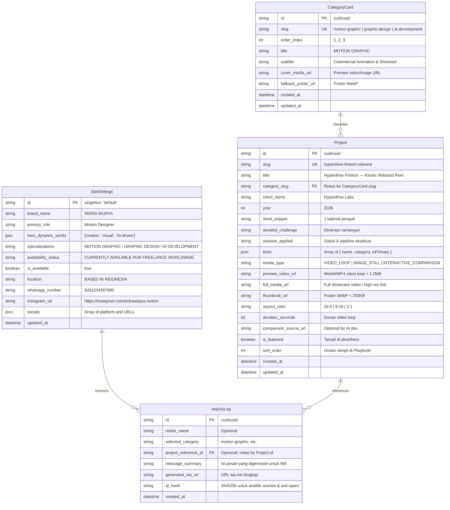
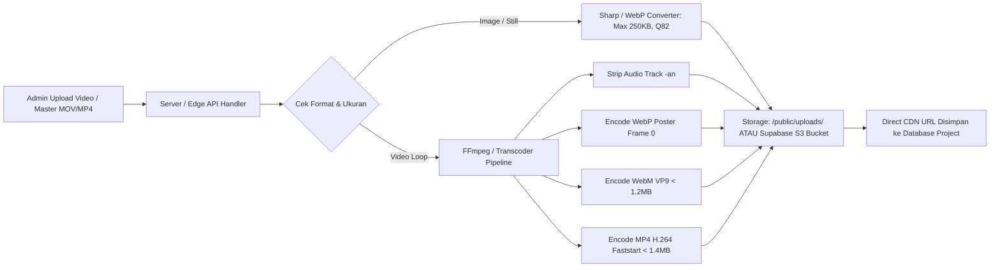
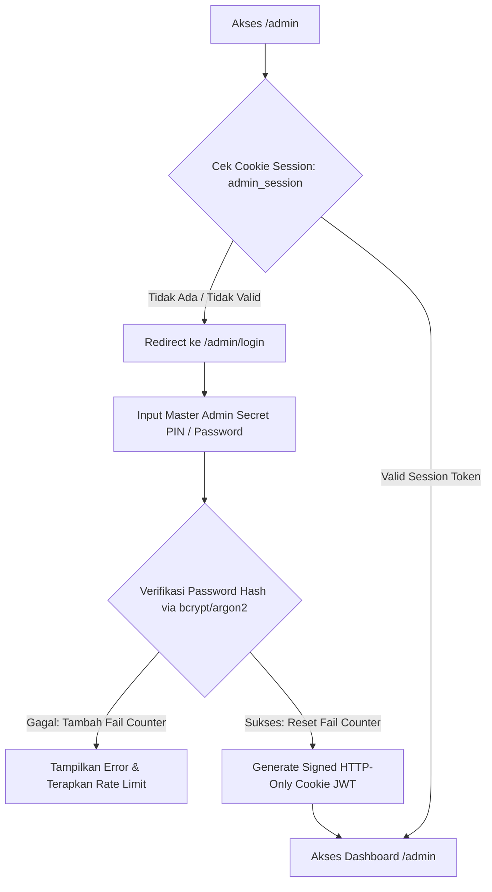

# SPEC-04: BACKEND ARCHITECTURE & CMS SPECIFICATION
**Project**: Portfolio Website Indra Wijaya — Creative Motion Designer & AI Development  
**Concept**: Spec-Driven Backend for Dynamic Project Content, Media Management, Availability Toggle & Direct Inquiry Tracking  
**Phase**: 04 — Backend Architecture, Database Modeling & Admin Governance  
**Status**: DRAFT (Awaiting Database Engine Choice: SQLite/Prisma vs Supabase)  
**References**: [01-data-architecture.md](file:///d:/WEBSITE%20PORTOFOLIO%20INDRA/specs/01-data-architecture.md) & [03-technical-architecture.md](file:///d:/WEBSITE%20PORTOFOLIO%20INDRA/specs/03-technical-architecture.md)  
**Constraint**: Murni spesifikasi arsitektur backend, skema ORM, kontrak API, dan pipeline keamanan. DILARANG menginstal package atau mengubah kode di `/src/` sebelum dokumen ini disetujui pengguna.

---

## 1. Database Schema & Relational ORM Modeling

Skema database dirancang untuk sinkron 1:1 dengan tipe data frontend pada `SPEC-01` (`SiteIdentitySchema`, `ProjectItemSchema`, `AdaptiveMedia`, dan `WhatsAppConfig`).



### Prisma ORM Schema Definition

```prisma
datasource db {
  provider = "sqlite" // atau "postgresql" jika menggunakan Supabase
  url      = env("DATABASE_URL")
}

generator client {
  provider = "prisma-client-js"
}

model SiteSettings {
  id                  String   @id @default("default")
  brandName           String   @default("INDRA WIJAYA")
  primaryRole         String   @default("Motion Designer")
  heroDynamicWords    String   // JSON string: ["motion", "visual", "AI-driven"]
  specializations     String   @default("MOTION GRAPHIC / GRAPHIC DESIGN / AI DEVELOPMENT")
  availabilityStatus  String   @default("CURRENTLY AVAILABLE FOR FREELANCE WORLDWIDE")
  isAvailable         Boolean  @default(true)
  location            String   @default("BASED IN INDONESIA")
  whatsappNumber      String   @default("6281234567890")
  instagramUrl        String   @default("https://instagram.com/indrawijaya.motion")
  socialsJson         String   // JSON string array: [{ platform, label, url }]
  updatedAt           DateTime @updatedAt
}

model CategoryCard {
  id                String    @id @default(cuid())
  slug              String    @unique
  orderIndex        Int       @default(1)
  title             String
  subtitle          String
  coverMediaUrl     String
  fallbackPosterUrl String
  projects          Project[]
  createdAt         DateTime  @default(now())
  updatedAt         DateTime  @updatedAt
}

model Project {
  id                    String        @id @default(cuid())
  slug                  String        @unique
  title                 String
  categorySlug          String
  category              CategoryCard  @relation(fields: [categorySlug], references: [slug])
  clientName            String
  year                  Int           @default(2026)
  shortSnippet          String
  detailedChallenge     String?
  solutionApplied       String?
  toolsJson             String        // JSON string: ToolBadge[]
  mediaType             String        @default("VIDEO_LOOP")
  previewVideoUrl       String
  fullMediaUrl          String
  thumbnailUrl          String
  aspectRatio           String        @default("16:9")
  durationSeconds       Int?
  comparisonSourceUrl   String?
  isFeatured            Boolean       @default(false)
  sortOrder             Int           @default(0)
  inquiries             InquiryLog[]
  createdAt             DateTime      @default(now())
  updatedAt             DateTime      @updatedAt

  @@index([categorySlug])
  @@index([sortOrder])
}

model InquiryLog {
  id                  String    @id @default(cuid())
  visitorName         String?
  selectedCategory    String
  projectReferenceId  String?
  project             Project?  @relation(fields: [projectReferenceId], references: [id], onDelete: SetNull)
  messageSummary      String
  generatedWaUrl      String
  ipHash              String?
  createdAt           DateTime  @default(now())

  @@index([selectedCategory])
  @@index([createdAt])
}
```

---

## 2. API Routes & Next.js Server Actions Contract

Untuk mempertahankan arsitektur *Zero Runtime Bottleneck* dan *Server Components (RSC)* di Next.js App Router, komunikasi data dibagi menjadi 2 layer:

### A. Public Read Layer (Frontend Consumption via Server Functions & ISR Caching)

```typescript
// src/lib/server/portfolio.ts
import { unstable_cache } from 'next/cache';

/**
 * Mengambil seluruh data portofolio publik dengan on-demand ISR revalidation tag.
 * Revalidate tag: 'portfolio-data'
 */
export const getPortfolioData = unstable_cache(
  async () => {
    // 1. Fetch SiteSettings (Singleton)
    // 2. Fetch 3 CategoryCards (Urut berdasarkan orderIndex ASC)
    // 3. Fetch Projects (Urut berdasarkan sortOrder ASC)
    return {
      siteIdentity: SiteIdentitySchema,
      categoryCards: CategoryCard[],
      projects: ProjectItemSchema[],
    };
  },
  ['portfolio-public-data'],
  { tags: ['portfolio-data'], revalidate: 3600 }
);
```

#### REST Endpoint Alternatif:
- `GET /api/portfolio`
  - **Output:** `{ success: true, data: { siteIdentity, categoryCards, projects } }`
  - **Header:** `Cache-Control: public, s-maxage=3600, stale-while-revalidate=86400`

### B. Public Inquiry Tracker Action (Lead Attribution)

```typescript
// src/actions/inquiry.actions.ts
'use server';

export interface CreateInquiryInput {
  category: 'motion-graphic' | 'graphic-design' | 'ai-development';
  projectTitle?: string;
  visitorName?: string;
  customMessage?: string;
}

export async function submitInquiryAction(input: CreateInquiryInput) {
  // 1. Validasi input via Zod schema
  // 2. Ambil WhatsApp Number aktif dari SiteSettings
  // 3. Format pesan teks otomatis kontekstual
  // 4. Simpan ke tabel InquiryLog
  // 5. Kembalikan format URL: https://wa.me/{phone}?text={encodedMessage}
  return {
    success: true,
    whatsappUrl: string,
  };
}
```

### C. Protected Admin Server Actions (CMS Mutators)

Setiap mutasi memanggil `revalidateTag('portfolio-data')` agar cache statis halaman utama langsung ter-update instan (*instant zero-lag CMS*):

```typescript
// src/actions/admin.actions.ts
'use server';

// 1. Update Pengaturan Situs & Toggle Availability
export async function updateSiteSettingsAction(formData: SiteSettingsInput): Promise<ActionResult>;

// 2. Proyek CRUD
export async function createProjectAction(input: ProjectCreateInput): Promise<ActionResult>;
export async function updateProjectAction(id: string, input: ProjectUpdateInput): Promise<ActionResult>;
export async function deleteProjectAction(id: string): Promise<ActionResult>;

// 3. Reorder Urutan Tampil (Drag-and-Drop)
export async function reorderProjectsAction(orderedIds: string[]): Promise<ActionResult>;
export async function reorderCategoriesAction(orderMap: { id: string; orderIndex: number }[]): Promise<ActionResult>;

// 4. Analitik Lead
export async function getInquiryLogsAction(page: number, limit: number): Promise<InquiryLogsResult>;
```

---

## 3. Media Upload & Video Optimization Pipeline

Aset motion graphics membutuhkan penanganan khusus agar tidak menyebabkan buffering atau frame-drop pada browser klien:



### Aturan Ketat File Media:
1. **Video Preview Loop (Motion Graphic):**
   - Wajib di-strip track audionya (`-an`).
   - Resolusi: 1280 × 720 (16:9) atau 720 × 1280 (9:16).
   - Ukuran file maksimal: **1.2 MB**.
   - Durasi optimal: 3–6 detik (seamless loop).
2. **Fallback Poster:**
   - Format: WebP.
   - Ukuran file maksimal: **150 KB**.
3. **Penyimpanan:**
   - **Opsi SQLite:** Folder `/public/uploads/projects/` (didukung native oleh Next.js static asset serving).
   - **Opsi Supabase:** Supabase Storage Bucket `portfolio-assets` dengan akses CDN publik.

---

## 4. Admin Authentication & Security Blueprint

Karena ini adalah situs portofolio personal seorang kreator independen, sistem keamanan dirancang **cepat, tanpa friction registrasi publik**, namun tahan terhadap brute-force dan tampering.



### Spesifikasi Keamanan:
1. **Autentikasi Berbasis Master Password / PIN:**
   - Variabel lingkungan: `ADMIN_SECRET_KEY` atau `ADMIN_PASSWORD_HASH`.
   - Tidak memerlukan multi-user role kompleks yang membebani database.
2. **Session Cookie:**
   - `httpOnly: true`, `secure: true` (saat production HTTPS), `sameSite: 'lax'`, `maxAge: 7 * 24 * 3600` (7 hari).
   - Di-sign menggunakan JWT (`jose` / Web Crypto API native) sehingga kompatibel dengan Next.js Edge Middleware.
3. **Next.js Middleware Protection:**
   - Middleware memblokir seluruh rute `/admin/*` (kecuali `/admin/login`) dan server actions yang memerlukan otorisasi admin.
4. **Anti-Brute Force Rate Limiting:**
   - Maksimal 5 percobaan login per 15 menit per alamat IP.

---

## 5. Backend Implementation Milestones (Untuk `TASKS.md`)

Langkah pengerjaan backend yang akan ditambahkan ke roadmap pengembangan:

| Milestone | Ruang Lingkup Pengerjaan | Kriteria Sukses |
| :--- | :--- | :--- |
| **Milestone B1** | **Database Setup & Seed Data Migration** | Skema database terpasang, migration berhasil dijalankan, dan skrip seed sukses menyalin data dari `src/data/portfolio-data.ts` ke database. |
| **Milestone B2** | **Server Actions & Dynamic Frontend Hydration** | Halaman utama (`page.tsx`) membaca data dinamis dari database melalui Server Function dengan caching tag ISR. Tombol `START PROJECT` & dialog WA mencatat log ke `InquiryLog`. |
| **Milestone B3** | **Lightweight Admin Studio (`/admin`)** | Halaman login aman `/admin/login`, dashboard visual `/admin` untuk mengubah teks hero, mengubah status availability (toggle hijau), menambah/mengedit/menghapus karya, dan drag-and-drop urutan karya. |

---

## 6. Pertimbangan Pemilihan Database Engine

Terdapat dua opsi stack database yang dapat digunakan:

### Opsi 1: SQLite + Prisma ORM (Rekomendasi untuk Self-Hosted / Zero-Cost)
* **Kelebihan:** 
  - Tidak memerlukan akun layanan cloud eksternal atau API key pihak ketiga.
  - Sangat cepat, file database tunggal tersimpan lokal di dalam project (`prisma/dev.db`).
  - Mudah dibackup (cukup salin 1 file).
  - Biaya operasional $0 (zero operational cost).
* **Kekurangan:** 
  - Jika dideploy ke platform *serverless ephemeral* (seperti Vercel free-tier tanpa persistent storage), file SQLite akan ter-reset saat deployment baru kecuali menggunakan *Turso (LibSQL)* atau VPS.

### Opsi 2: Supabase (PostgreSQL Cloud + Built-in Storage)
* **Kelebihan:** 
  - Database PostgreSQL cloud dengan SLA tinggi.
  - Sudah dilengkapi fitur built-in Storage Bucket untuk upload file video & gambar langsung dari browser.
  - Dashboard GUI web bawaan dari Supabase untuk inspeksi data langsung.
  - Sangat cocok jika dideploy ke Vercel.
* **Kekurangan:** 
  - Memerlukan konfigurasi akun Supabase, URL project, dan API Service Keys (`SUPABASE_URL`, `SUPABASE_ANON_KEY`, `SUPABASE_SERVICE_ROLE_KEY`).
