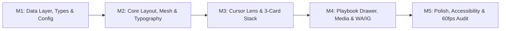

# IMPLEMENTATION ROADMAP (TASKS.md)
**Project**: Portfolio Website Indra Wijaya — Creative Motion Designer & AI Development  
**Concept**: Interactive Dark Minimalist with Cursor Lens / Refraction & Dynamic Showreel (Inspired by Purrweb Designer Portfolio)  
**Status**: APPROVED & FINALIZED FOR EXECUTION  
**References**:
- [01-data-architecture.md](file:///d:/WEBSITE%20PORTOFOLIO%20INDRA/specs/01-data-architecture.md) (Data Models, 3 Categories & Direct Contacts)
- [02-interaction-behavior.md](file:///d:/WEBSITE%20PORTOFOLIO%20INDRA/specs/02-interaction-behavior.md) (State Machines, Lens Optics & Stacked Cards)
- [03-technical-architecture.md](file:///d:/WEBSITE%20PORTOFOLIO%20INDRA/specs/03-technical-architecture.md) (Tech Stack, Component Tree & Pipeline)

---

## Ringkasan Milestone & Eksekusi Bertahap

| Milestone | Ruang Lingkup Utama | File & Komponen Kunci | Status |
| :---: | :--- | :--- | :---: |
| **M1** | Data Layer, Types & Configuration Lock | `src/types/portfolio.ts`, `src/data/portfolio-data.ts`, `src/utils/contact-links.ts` | ✅ Selesai (Verified) |
| **M2** | Core Layout, Mesh & Hero Typography | `TopNavbar.tsx`, `AmbientBackground.tsx`, `HeroTypography.tsx` | ⏳ Antrean |
| **M3** | Interactive Cursor Lens & 3-Card Stack | `CursorLens.tsx`, `CategoryCardStack.tsx` (DOF blur & scale) | ⏳ Antrean |
| **M4** | Playbook Drawer, Adaptive Media & WA/IG | `PlaybookModal.tsx`, `AdaptiveProjectMedia.tsx`, `QuickContactModal.tsx` | ⏳ Antrean |
| **M5** | Polish, Accessibility & 60fps Audit | Lenis smooth scroll, magnetic effects, touch swipe, Lighthouse audit | ⏳ Antrean |

---

## Detail Checklist Tugas Per Milestone

### MILESTONE 1: Data Layer, Types & Configuration Lock
> **Tujuan:** Mengunci seluruh kontrak data TypeScript, dataset statis profil Indra Wijaya (3 kategori karya), serta generator tautan konversi langsung WhatsApp/Instagram tanpa form rumit.

- [x] **Task 1.1: TypeScript Interfaces & Schema (`src/types/portfolio.ts`)**
  - Implementasikan seluruh kontrak tipe data mengacu pada `SPEC-01`:
    - `SiteIdentity`: wordmark `INDRA WIJAYA`, role `Motion Designer`, kinetic headline config, metadata bar, hero showreel sources.
    - `ProjectCategory`: `'motion-graphic' | 'graphic-design' | 'ai-development'`.
    - `ProjectItem`: `id`, `slug`, `title`, `category`, `year`, `clientOrContext`, `description`, `media` (adaptive), `tools`, `featured`.
    - `ToolStack`: Core creative tools (`Adobe After Effects`, `Adobe Premiere Pro`, `Adobe Photoshop`, `Adobe Illustrator`) dan AI tools slot (`Midjourney`, `Runway Gen-3`, `ComfyUI`, dll.).
    - `ContactCTA`: `WhatsAppConfig` (phone number, default text, pre-filled category text) dan `InstagramConfig` (handle `@indrawijaya.motion`, profile URL).
    - `CursorState` & `MediaPlaybackState` kontrak tipe interaksi mengacu pada `SPEC-02`.

- [x] **Task 1.2: Static Content & Mock Data (`src/data/portfolio-data.ts`)**
  - Buat dataset statis terpusat untuk profil **INDRA WIJAYA**:
    - Array rotasi kata kinetik: `["motion", "visual", "AI-driven"]`.
    - Metadata Bar:
      - Spesialisasi: `MOTION GRAPHIC / GRAPHIC DESIGN / AI DEVELOPMENT`
      - Status: `CURRENTLY AVAILABLE FOR FREELANCE & COLLABORATION`
      - Lokasi: `INDONESIA (WORLDWIDE REMOTE)`
    - Koleksi proyek terkurasi untuk 3 kategori:
      1. *Motion Graphic* (Preview loop hening, 16:9 cinematic commercial & reels).
      2. *Graphic Design* (High-res key visual, editorial poster, 1:1 square layout).
      3. *AI Development* (Generative AI video pipeline, before/after RAW comparison).

- [x] **Task 1.3: Direct Conversion Helper (`src/utils/contact-links.ts`)**
  - Buat fungsi utilitas generator tautan WhatsApp:
    - Fungsi `getWhatsAppUrl(category?: ProjectCategory, projectTitle?: string): string` yang meng-encode nomor WhatsApp dan template pesan dinamis:
      - Motion Graphic: *"Halo Indra, saya tertarik berdiskusi mengenai proyek Motion Graphic / Commercial Animation untuk brand saya."*
      - Graphic Design: *"Halo Indra, saya tertarik berdiskusi mengenai kebutuhan Visual Identity / Graphic Design proyek kami."*
      - AI Development: *"Halo Indra, saya tertarik berdiskusi mengenai eksplorasi AI Creative Pipeline & Visual Generation untuk campaign kami."*
  - Ekspor konstanta link Instagram langsung (`https://instagram.com/indrawijaya.motion`).

*Kriteria Keberhasilan M1:* Kompilasi TypeScript lulus 100%, seluruh data statis dan helper URL WhatsApp/IG teruji valid secara unit.

---

### MILESTONE 2: Core Layout, Dark Mesh Gradient & Hero Typography
> **Tujuan:** Membangun kerangka tata letak presisi khas Purrweb: Top Navbar 4 kolom, latar belakang ambient dark mesh bertekstur noise halus, dan tipografi kinetik Hero dengan aksen serif italic serta metadata bar pojok kiri bawah.

- [ ] **Task 2.1: Top Navigation Bar (`src/components/layout/TopNavbar.tsx`)**
  - Bangun header navigasi 4 kolom presisi:
    - Kolom 1 (Kiri): Monogram/Wordmark `INDRA WIJAYA` (font tebal monokrom).
    - Kolom 2: `PLAYBOOK` (membuka drawer/katalog karya).
    - Kolom 3: `SOCIALS` (popover/tautan langsung Behance, Vimeo, LinkedIn, YouTube).
    - Kolom 4 (Kanan): `CONTACTS` (trigger quick contact WA/IG) + `LiveAvailabilityPill` (titik hijau berdenyut halus).

- [ ] **Task 2.2: Ambient Dark Mesh Background (`src/components/hero/AmbientBackground.tsx`)**
  - Buat latar belakang kanvas gelap bernuansa biru-hitam (`#080808` hingga `#0c0e14`) dengan tekstur *subtle noise/grain* CSS SVG filter.
  - Sediakan layer ganda untuk efek *sharp/glowing reveal* yang akan dihubungkan dengan kursor lensa.

- [ ] **Task 2.3: Hero Kinetic Typography & Metadata Bar (`src/components/hero/HeroTypography.tsx`)**
  - Implementasikan kalimat utama berukuran besar: `"Creative "` + `[dynamic_word]` + `" designer"`.
  - Kata dinamis (`"motion"`, `"visual"`, `"AI-driven"`) menggunakan font *serif italic* bernuansa hangat (oranye/emas elegan) yang bertransisi halus setiap 2.5 detik menggunakan GSAP/CSS animation.
  - Bangun 2 kolom metadata di pojok kiri bawah:
    - Baris 1: `MOTION GRAPHIC / GRAPHIC DESIGN / AI DEVELOPMENT`
    - Baris 2: `CURRENTLY AVAILABLE FOR FREELANCE & COLLABORATION`
    - Baris 3: `INDONESIA (WORLDWIDE REMOTE)`

*Kriteria Keberhasilan M2:* Antarmuka Hero tampil presisi dengan hierarki tipografi mewah, rotasi kata kinetik berjalan mulus tanpa layout shift, dan metadata bar kiri bawah terkunci rapi.

---

### MILESTONE 3: Interactive Cursor Lens & 3-Card Category Stack
> **Tujuan:** Menghadirkan dua interaksi visual utama: lingkaran lensa kursor pembuka layer video/mesh tajam di desktop (dengan fallback auto-pan di mobile) dan tumpukan 3 kartu interaktif dengan efek Depth of Field di kanan bawah.

- [ ] **Task 3.1: Custom Magnifying Lens Cursor (`src/components/interactive/CursorLens.tsx`)**
  - Implementasikan lingkaran kursor lensa (*glass border + SVG ticks optik + radial clip-path mask*) yang mengikuti koordinat X/Y pointer dengan *smooth LERP inertia* ($\lambda = 0.14$) di desktop.
  - Menyingkap video sharp / glowing layer di bawah ambient background secara presisi 60 FPS.
  - Sediakan deteksi layar sentuh (*touchscreen fallback*): beralih otomatis ke mode *ambient auto-panning* (kurva Lissajous) atau *gyroscope tilt reveal* saat dibuka di ponsel/tablet.

- [ ] **Task 3.2: 3-Card Category Stack (`src/components/hero/CategoryCardStack.tsx`)**
  - Bangun tumpukan 3 kartu interaktif di area kanan bawah dengan efek *Depth of Field* bertingkat:
    1. **`MOTION GRAPHIC`** (Posisi terdepan: `scale(1.00)`, fokus tajam `blur(0px)`, `z-index: 3`, memutar *muted video loop* teroptimasi).
    2. **`GRAPHIC DESIGN`** (Posisi tengah: `scale(0.92)`, `translateY(-14px)`, `blur(6px)`, `opacity: 0.85`, `z-index: 2`).
    3. **`AI DEVELOPMENT`** (Posisi belakang: `scale(0.85)`, `translateY(-28px)`, `blur(12px)`, `opacity: 0.65`, `z-index: 1`).
  - Sediakan 3 titik indikator (*pagination dots*) yang mencerminkan status kartu yang sedang berada di depan.
  - Implementasikan rotasi urutan kartu (*deck shuffle*) dengan animasi GSAP spring saat kartu belakang di-klik/di-hover/di-swipe.
  - Sertakan tombol aksi melingkar (`→`) pada kartu terdepan untuk langsung membuka katalog karya sesuai kategori tersebut.

*Kriteria Keberhasilan M3:* Kursor lensa menembus lapisan blur pada 60 FPS; tumpukan kartu kanan bawah dapat di-shuffle dengan transisi blur-to-sharp yang mulus; interaksi terasa responsif dan berkelas.

---

### MILESTONE 4: Playbook Drawer, Adaptive Media & Direct Contact (WA/IG)
> **Tujuan:** Membangun katalog karya lengkap dengan filtrasi 3 kategori, pemutaran media adaptif hemat memori, dan popover konversi cepat WhatsApp/Instagram.

- [ ] **Task 4.1: Playbook Project Drawer/Modal (`src/components/playbook/PlaybookModal.tsx`)**
  - Buat antarmuka katalog karya (*The Playbook*) yang dapat dibuka via nav `PLAYBOOK` atau klik kartu kategori:
    - Tab filtrasi instan: `MOTION GRAPHIC` (default), `GRAPHIC DESIGN`, `AI DEVELOPMENT`, dan `ALL`.
    - Kartu karya menampilkan judul, tahun, klien/konteks, ringkasan deskripsi, dan *tool badges* (`After Effects`, `Premiere Pro`, `Photoshop`, `Illustrator`, `Midjourney`, `ComfyUI`).

- [ ] **Task 4.2: Adaptive Media Player (`src/components/media/AdaptiveProjectMedia.tsx`)**
  - Enforce aturan performa: Video preview pada kategori `Motion Graphic` hanya berputar saat berada di kartu terdepan atau viewport aktif, dan seketika `pause()` saat berada di belakang tumpukan atau modal ditutup.
  - Format `Graphic Design` dan `AI Development` menggunakan *crisp still image viewer* (WebP) dengan opsi tampilan perbandingan prompt/RAW sebelum dan sesudah.

- [ ] **Task 4.3: Quick Connect WA & IG Popover (`src/components/contact/QuickContactModal.tsx`)**
  - Hubungkan tombol `CONTACTS`, `SOCIALS`, dan tombol inquiry di setiap kartu proyek langsung ke WhatsApp dan Instagram:
    - WhatsApp: Membuka chat dengan *pre-filled text* dinamis sesuai kategori karya yang sedang dibuka.
    - Instagram: Membuka profil `@indrawijaya.motion` di tab baru.

*Kriteria Keberhasilan M4:* Playbook dapat difilter secara instan; kuota video aktif terkendali tanpa drop frame; alur konversi WhatsApp dan Instagram berfungsi tanpa kendala.

---

### MILESTONE 5: Polish, Accessibility & 60fps Performance Audit
> **Tujuan:** Menyelaraskan inersia smooth scrolling Lenis, menambahkan efek magnetik mikro, memastikan fallback aksesibilitas OS, dan memverifikasi performa 60–120 FPS tanpa kebocoran memori.

- [ ] **Task 5.1: Smooth Scroll (Lenis) & Magnetic Micro-interactions**
  - Inisialisasi Lenis smooth scroll yang tersinkronisasi ke RAF ticker GSAP.
  - Terapkan efek magnetik (*damped spring physics*) pada tombol navigasi, CTA WhatsApp/IG, dan tombol panah kartu.
- [ ] **Task 5.2: Mobile Touch Swipe & `prefers-reduced-motion` Fallback**
  - Tambahkan gesture swipe pada *CategoryCardStack* untuk navigasi kartu yang natural di ponsel.
  - Hormati preferensi `prefers-reduced-motion` sistem operasi (nonaktifkan rotasi blur ekstrem bila diminta).
- [ ] **Task 5.3: Final Build Verification & Zero TypeScript/ESLint Error Check**
  - Eksekusi `npm run build`: pastikan zero type error dan zero lint warning.
  - Uji stabilitas frame rate 60–120 FPS di Chrome DevTools Performance Monitor.
  - Verifikasi audit Lighthouse: Performance $\ge 90$, Accessibility $\ge 95$, SEO $\ge 95$.

*Kriteria Keberhasilan M5:* Website beroperasi pada 60–120 FPS mentok tanpa stuttering; transisi lensa dan kartu terasa organik; siap untuk tahap uji coba dan deployment.

---

## Aturan Eksekusi
1. Pengerjaan dilakukan secara teratur per milestone, diawali dari **Milestone 1**.
2. Setiap milestone yang selesai akan diverifikasi dan diuji fungsionalitasnya sebelum melangkah ke milestone berikutnya.
3. Proyek siap dimulai begitu perintah `"MULAI MILESTONE 1"` diberikan.
