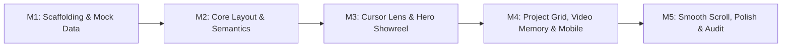

# IMPLEMENTATION ROADMAP (TASKS.md)
**Project**: Portfolio Website Indra Wijaya — Motion Designer & Creative Studio  
**Status**: APPROVED & READY FOR EXECUTION  
**References**:
- [01-data-architecture.md](file:///d:/WEBSITE%20PORTOFOLIO%20INDRA/specs/01-data-architecture.md) (Data Models & Schemas)
- [02-interaction-behavior.md](file:///d:/WEBSITE%20PORTOFOLIO%20INDRA/specs/02-interaction-behavior.md) (State Machines & Physics)
- [03-technical-architecture.md](file:///d:/WEBSITE%20PORTOFOLIO%20INDRA/specs/03-technical-architecture.md) (Tech Stack, Tree & Pipeline)

---

## Ringkasan Milestone & Estimasi Alur Pengerjaan

| Milestone | Fokus Utama | Luaran Kritis (*Key Deliverables*) | Status |
| :---: | :--- | :--- | :---: |
| **M1** | Scaffolding & Static Mock Data | Next.js 15, Tailwind, Zustand, GSAP, TS types & static dataset | ✅ Selesai (Verified) |
| **M2** | Core Layout & Typography | Semantic HTML, Header, Hero, Grid, Services, Bio, Footer | ⏳ Antrean |
| **M3** | Interactive Cursor Lens & Optics | Dual-Layer Video Reveal, State Machine Kursor, Magnetic Button | ⏳ Antrean |
| **M4** | Project Grid & Media Concurrency | Hover-to-Play, Concurrency Budget (Max 2), FLIP Modal, Mobile Gyro | ⏳ Antrean |
| **M5** | Polish, Smooth Scroll & Audit | Lenis RAF Sync, Audio Toggle, 60 FPS Memory GC, Performance Audit | ⏳ Antrean |

---

## Detail Breakdown Tugas (*Checklist*)

### MILESTONE 1: Project Scaffolding & Static Mock Data Implementation
> **Tujuan:** Membangun fondasi proyek Next.js 15 App Router yang bersih, mengonfigurasi Tailwind CSS dengan token dark minimalist, serta mengimplementasikan skema data statis dari `SPEC-01` secara type-safe.

- [x] **Task 1.1: Next.js Project Initialization**
  - Inisialisasi Next.js 15 App Router dengan TypeScript (`strict: true`), ESLint, dan Tailwind CSS.
  - Bersihkan boilerplate default Next.js (`globals.css`, `page.tsx`).
- [x] **Task 1.2: Dependencies Installation**
  - Pasang pustaka inti: `zustand` (state telemetry), `gsap` (animasi timeline), `@studio-freight/lenis` / `lenis` (smooth scroll), `lucide-react` (vektor ikon), `clsx`, dan `tailwind-merge`.
- [x] **Task 1.3: Design Tokens & CSS Custom Properties**
  - Konfigurasi `src/app/globals.css` dengan palet warna dark luxury:
    - Pure black `#080808`, card surface `#0f0f11`, elevated border `#202024`, aksen putih monokrom `#f5f5f7`.
    - Atur konfigurasi font sans (*Inter*) dan display font (*Syne*) via `next/font/google`.
- [x] **Task 1.4: TypeScript Type Contracts Implementation**
  - Buat file `src/types/content.types.ts` mengadopsi kontrak data dari `SPEC-01`:
    - `SiteIdentitySchema`, `ToolItem`, `SocialLink`, `AvailabilityStatus`.
    - `ShowreelHeroSchema`, `KineticKeyword`.
    - `ProjectItemSchema`, `ProjectCategory`, `AspectRatioType`, `RoleContribution`.
    - `ServicePackageSchema`, `DeliverableItem`.
  - Buat file `src/types/interaction.types.ts` mengadopsi kontrak state dari `SPEC-02` (`CursorState`, `MediaPlaybackState`).
- [x] **Task 1.5: Static Data Models Implementation**
  - Buat `src/data/site-identity.data.ts` (Identitas studio/personal Indra Wijaya, bio, availability badge, 12+ software tools terklasifikasi, media sosial).
  - Buat `src/data/hero.data.ts` (Headline teks, 4 kinetic keywords, URL video dual-layer).
  - Buat `src/data/projects.data.ts` (6 karya komersial, motion ads, kinetic branding, dan visual 3D lengkap dengan rasio 16:9, 9:16, 4:5, deskripsi challenge/solution, peran teknis, dan durasi).
  - Buat `src/data/services.data.ts` (3 paket layanan terstruktur: Commercial Motion, 3D Product, Kinetic Identity).
- [x] **Task 1.6: Static Asset Directory & Placeholder Stubs**
  - Siapkan folder `public/videos/hero/`, `public/videos/projects/`, `public/posters/`, dan `public/icons/`.
  - Pasang aset awal/stubs placeholder untuk memastikan build lokal tidak mengalami broken links.

*Kriteria Keberhasilan M1:* `npm run build` sukses 100% tanpa error TypeScript dan seluruh data statis terverifikasi valid sesuai kontrak skema.

---

### MILESTONE 2: Core Layout, Typography & Semantic HTML Structure
> **Tujuan:** Merangkai kerangka antarmuka lengkap tanpa animasi berat terlebih dahulu, memastikan struktur dokumen memiliki aksesibilitas tinggi (*SEO & Semantic HTML*), heading hierarchy yang benar, dan responsivitas penuh di desktop maupun mobile.

- [ ] **Task 2.1: Root Layout & Metadata Configuration**
  - Modifikasi `src/app/layout.tsx` dengan metadata lengkap (Title, Description, OpenGraph, Viewport, Theme color dark `#080808`).
  - Terapkan font display dan sans via `next/font`.
- [ ] **Task 2.2: Global Navigation Header**
  - Buat `src/components/layout/GlobalHeader.tsx`:
    - Monogram studio / wordmark.
    - `AvailabilityBadge.tsx` (Status ketersediaan proyek dengan indikator titik hijau berdenyut halus).
    - Anchor links nav (`Works`, `Services`, `Profile`, `Contact`).
    - Quick CTA `"Start a Project"`.
- [ ] **Task 2.3: Hero Section Semantic Layout**
  - Buat `src/components/modules/hero/HeroSection.tsx`:
    - Heading `<h1>` tunggal dengan headline statis dan slot kinetic keyword.
    - Subtext filosofi studio.
    - Kontainer dual video canvas (placeholder frame 16:9).
    - Tombol aksi primer `"Watch Showreel"` dan sekunder `"Book a Project"`.
- [ ] **Task 2.4: Selected Works Gallery Grid**
  - Buat `src/components/modules/works/SelectedWorksSection.tsx`:
    - Header seksi dan subjudul.
    - `CategoryFilterBar.tsx` (Filter kategori: All, Motion Graphics, Commercial, 3D, Branding).
    - Layout grid responsif (mendukung variasi rasio 16:9, 9:16, 4:5).
    - `ProjectCard.tsx` statis (tampilan poster WebP, judul, nama klien, tahun, dan chip peran teknis).
- [ ] **Task 2.5: Services & Capabilities Showcase**
  - Buat `src/components/modules/services/ServicesSection.tsx` & `ServicePackageCard.tsx`:
    - Kartu paket layanan dengan daftar deliverable checklist dan estimasi turnaround.
- [ ] **Task 2.6: Studio Profile & Software Arsenal**
  - Buat `src/components/modules/profile/StudioProfileSection.tsx` & `ToolsArsenalGrid.tsx`:
    - Pernyataan bio & filosofi kreatif.
    - Grid software tools yang dikelompokkan berdasarkan kategori (Compositing, 3D, Color, Plugins).
- [ ] **Task 2.7: Contact & Brief Inquiry Section**
  - Buat `src/components/modules/contact/ContactSection.tsx` & `InquiryBriefForm.tsx`:
    - Form seleksi cepat tipe proyek, timeline, dan tombol kontak langsung (Email, WhatsApp, Discord).
- [ ] **Task 2.8: Global Footer**
  - Buat `src/components/layout/GlobalFooter.tsx`:
    - Jam real-time live WIB (GMT+7 Asia/Jakarta) dengan indikator detik.
    - Social links dan hak cipta.

*Kriteria Keberhasilan M2:* Halaman dapat di-render secara statis di browser dengan struktur semantik sempurna, ramah pembaca layar (*screen reader*), dan responsif di resolusi 375px hingga 1920px+.

---

### MILESTONE 3: Interactive Cursor Lens & Showreel Dual-Layer Reveal
> **Tujuan:** Mengimplementasikan fitur tanda tangan visual portofolio: state machine kursor interaktif, tombol magnetik dengan rumus pegas teredam, dan kanvas video ganda dengan masking lingkaran aperture berkecepatan 60 FPS.

- [ ] **Task 3.1: Zustand Cursor State Store**
  - Buat `src/stores/cursorStore.ts` untuk mengelola state (`DEFAULT`, `LENS_REVEAL`, `PROJECT_HOVER`, `MAGNETIC_BUTTON`, `HIDDEN`) dan posisi koordinat kursor `(x, y)` tanpa memicu siklus re-render React.
- [ ] **Task 3.2: Custom Cursor Follower Portal**
  - Buat `src/components/cursor/CustomCursor.tsx`:
    - Inner dot (8px) dan outer follower ring (36px).
    - Rumus interpolasi LERP ($\lambda = 0.14$) untuk pergerakan trailing sinematik.
    - Event listener `pointermove`, `mouseleave`, dan `mouseenter`.
- [ ] **Task 3.3: Lens Optics Markings & Telemetry**
  - Buat `src/components/cursor/LensCoordinates.tsx` dan `LensApertureRings.tsx`:
    - Tampilan badge koordinat live `[X: ..., Y: ...]` saat state `LENS_REVEAL`.
    - Ticks konsentris optik SVG (atas, kanan, bawah, kiri) dan aperture ring 1px.
- [ ] **Task 3.4: Magnetic Button Spring Physics**
  - Buat hook `src/hooks/useMagneticEffect.ts` dengan rumus pegas teredam ($k = 0.35, d = 0.65$).
  - Buat komponen atomik `src/components/atomic/MagneticButton.tsx` yang menarik kursor follower dan menggeser elemen tombol secara halus.
- [ ] **Task 3.5: Dual-Layer Video Reveal Canvas**
  - Buat `src/components/modules/hero/HeroDualVideoCanvas.tsx`:
    - Layer 0: `<video>` Ambient Blur (`filter: blur(28px)`).
    - Layer 1: `<video>` Sharp Reveal dengan CSS `clip-path: circle(R at X Y)`.
    - Transformasi koordinat lokal mouse terhadap bounding rectangle hero section.
    - Dynamic velocity expansion: Radius kursor mengembang saat digerakkan cepat ($R = 160\text{px} \rightarrow 240\text{px}$).
- [ ] **Task 3.6: Dual-Video Time Synchronizer**
  - Implementasikan logika sinkronisasi master-slave di hero canvas untuk mengoreksi *drift* waktu bila $\Delta t > 0.065\text{s}$.
- [ ] **Task 3.7: Kinetic Typography Loop**
  - Buat `src/components/modules/hero/KineticHeadlineLoop.tsx` dengan GSAP timeline untuk memutar kata kunci kinetik secara dinamis dengan efek split-text / fade slide.

*Kriteria Keberhasilan M3:* Saat mouse digerakkan di atas Hero Showreel, lingkaran lensa menembus lapisan blur dan menyingkap video tajam di bawahnya secara presisi pada 60 FPS; tombol magnetik bereaksi saat didekati; kursor bertransisi mulus antar state.

---

### MILESTONE 4: Project Grid, Hover-to-Play Video Optimization & Mobile Fallback
> **Tujuan:** Menghidupkan galeri Selected Works dengan pemutaran video hover yang hemat daya, menegakkan batas konkurensi memori GPU, membangun modal detail transisi FLIP, dan menyediakan fallback gyroscope untuk perangkat mobile.

- [ ] **Task 4.1: Media Playback Zustand Store**
  - Buat `src/stores/mediaPlaybackStore.ts` untuk memantau antrean video dan menegakkan **Concurrency Budget** (Maksimal 2 video aktif bersamaan di Desktop, 1 di Mobile).
- [ ] **Task 4.2: Intersection Observer Multi-Zone Hook**
  - Buat `src/hooks/useIntersectionVideo.ts` yang mengelola 3 zona memori:
    - *Zona A (>600px)*: `IDLE` (unloaded).
    - *Zona B (300px)*: `PRELOADING` (`preload="metadata"`).
    - *Zona C (Viewport $\ge 0.5$)*: Urutkan kandidat berdasarkan *Center-Proximity Distance* dan jalankan `.play()` hanya untuk kuota teratas.
- [ ] **Task 4.3: VideoPreviewPlayer Component**
  - Buat `src/components/media/VideoPreviewPlayer.tsx`:
    - Memuat WebM primer dan MP4 fallback tanpa audio track.
    - Transisi fade-in poster WebP ke video loop saat video siap diputar.
    - Sinkronisasi state kursor ke `PROJECT_HOVER` (kursor membesar dengan badge `"VIEW"`).
- [ ] **Task 4.4: Project Detail Modal (FLIP Showcase)**
  - Buat `src/components/modules/works/ProjectDetailModal.tsx`:
    - Ketika kartu diklik: Seketika hentikan seluruh video latar belakang (`FULL_MODAL_PLAYING`).
    - Animasi ekspansi geometri kartu ke layar penuh (*FLIP transition*).
    - Player video resolusi tinggi penuh dengan audio fade-in eksponensial (300ms).
    - Tombol tutup / ESC handler dengan pembersihan memori total (`video.src = ""`).
- [ ] **Task 4.5: Mobile & Tablet Fallback Engine**
  - Buat `src/hooks/useDeviceOrientation.ts`: Membaca event `deviceorientation` (`gamma` dan `beta`) untuk menggerakkan fokus lensa aperture di Hero saat perangkat dimiringkan.
  - Buat `src/components/modules/hero/GyroscopeController.ts`:
    - Mode 1: Tilt Gyroscope.
    - Mode 2: Auto-panning Lissajous curve loop jika sensor tidak tersedia.
    - Mode 3: Touch spotlight pulse saat layar disentuh.

*Kriteria Keberhasilan M4:* Di galeri karya hanya maksimal 2 video yang berputar bersamaan di layar desktop; membuka proyek mematikan video lain dan memutar video penuh; membuka situs di smartphone memberikan pengalaman reveal showreel melalui kemiringan ponsel (*gyroscope*) atau orbit otonom.

---

### MILESTONE 5: Polish, Smooth Scroll (Lenis), & Performance Audit
> **Tujuan:** Mengintegrasikan inertia smooth scrolling, menyelaraskan master audio ambience, memastikan standar aksesibilitas OS (*Reduced Motion*), dan mengeksekusi audit performa akhir untuk menjamin 60–120 FPS tanpa kebocoran memori.

- [ ] **Task 5.1: Lenis Smooth Scroll & GSAP RAF Sync**
  - Buat `src/components/layout/SmoothScrollProvider.tsx`:
    - Inisialisasi Lenis dengan durasi 1.2s dan kurva redaman halus.
    - Tautkan perputaran loop Lenis ke dalam `gsap.ticker.add()` untuk eliminasi stuttering antar scroll dan animasi.
- [ ] **Task 5.2: Master Audio Ambience & Sound Toggle**
  - Buat `src/components/media/AudioGlobalToggle.tsx` pada header:
    - Kontrol mute/unmute audio studio ambience dengan visualizer gelombang audio mini bergerak.
- [ ] **Task 5.3: Reduced Motion & Accessibility Hardening**
  - Buat `src/hooks/useReducedMotion.ts`:
    - Menghormati pengaturan `prefers-reduced-motion` sistem operasi (menonaktifkan dynamic lens stretch dan scroll smoothing ekstrem bila diminta pengguna).
- [ ] **Task 5.4: Asset Pipeline Audit & Optimization**
  - Verifikasi seluruh video pratinjau di `public/videos/`: pastikan track audio ter-strip murni pada level kontainer, file WebM/MP4 $\le 1.2\text{MB}$, dan poster WebP $\le 85\text{KB}$.
- [ ] **Task 5.5: Comprehensive Performance & Lighthouse Audit**
  - Jalankan pengujian memori di Chrome DevTools: pastikan tidak ada kebocoran DOM ref atau listener saat navigasi.
  - Verifikasi skor Lighthouse: Performance $\ge 90$, Accessibility $\ge 95$, Best Practices $\ge 95$, SEO $\ge 95$.
  - Uji kestabilan frame rate pada resolusi layar monitor tinggi (1440p / 4K).

*Kriteria Keberhasilan M5:* Website beroperasi pada 60–120 FPS stabil, interaksi kursor terasa mewah dan responsif, scroll terasa organik, video terkelola tanpa memory leak, dan seluruh metrik audit terpenuhi.

---

## Aturan Eksekusi
1. Pengerjaan dilakukan secara bertahap dimulai dari **Milestone 1**.
2. Setiap kali satu milestone selesai, verifikasi teknis dan pengujian fungsional akan dijalankan sebelum melangkah ke milestone berikutnya.
3. Proyek siap dimulai begitu perintah `"MULAI MILESTONE 1"` diberikan.
